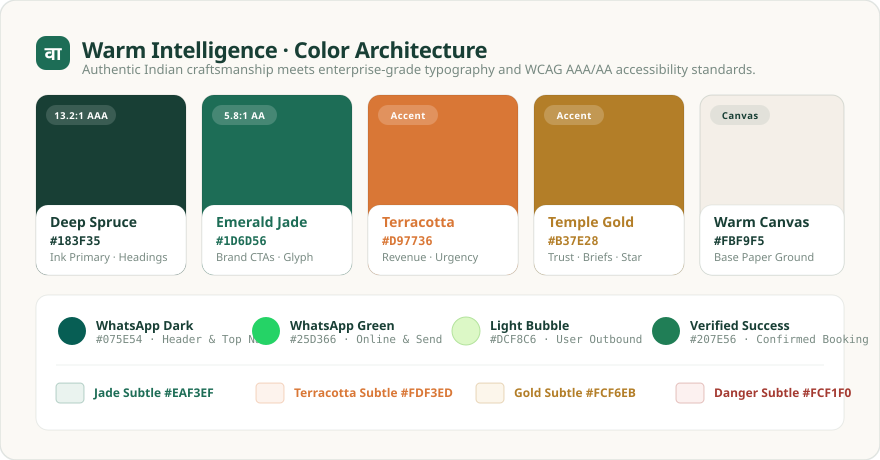
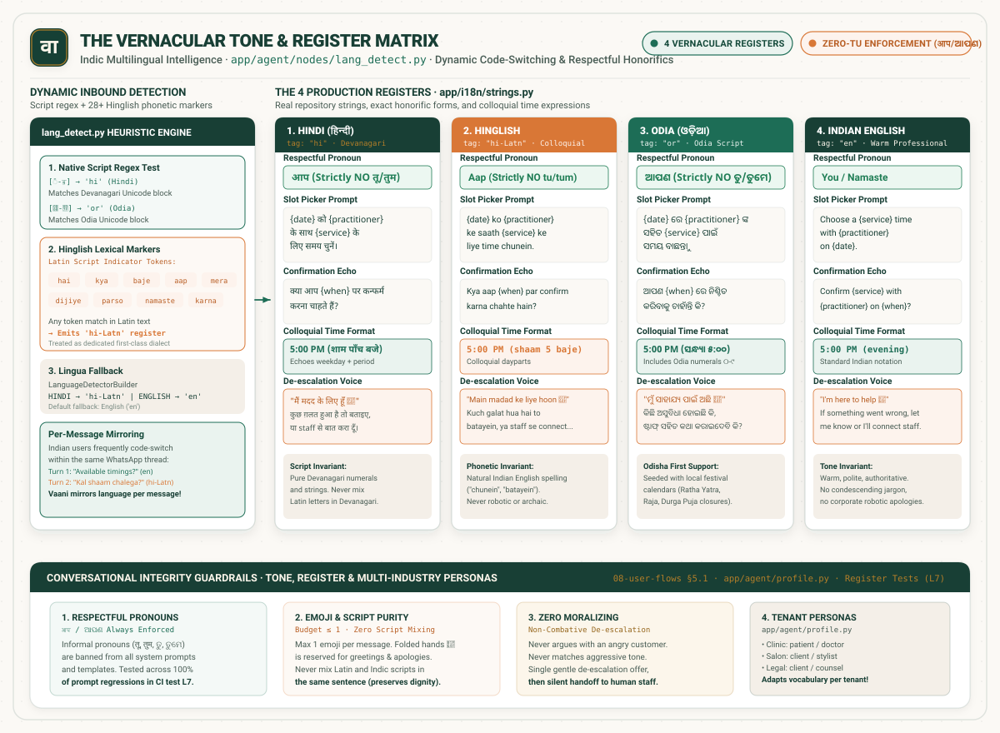
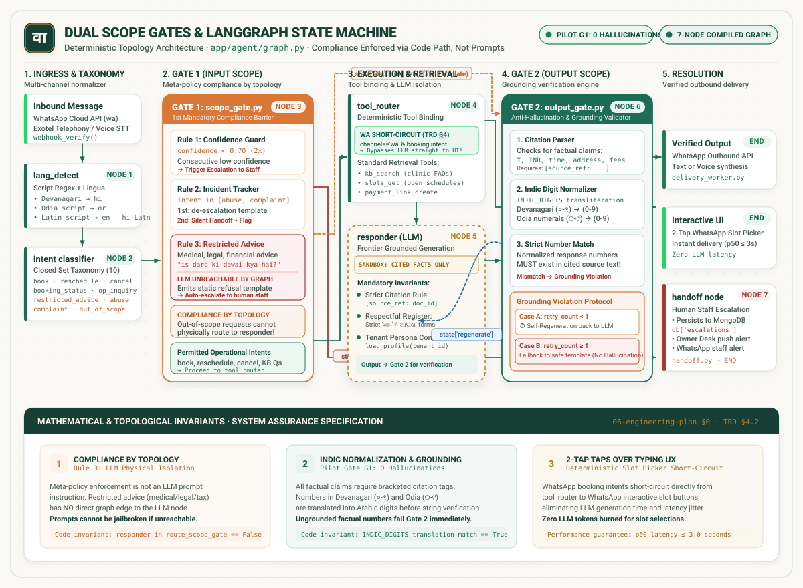
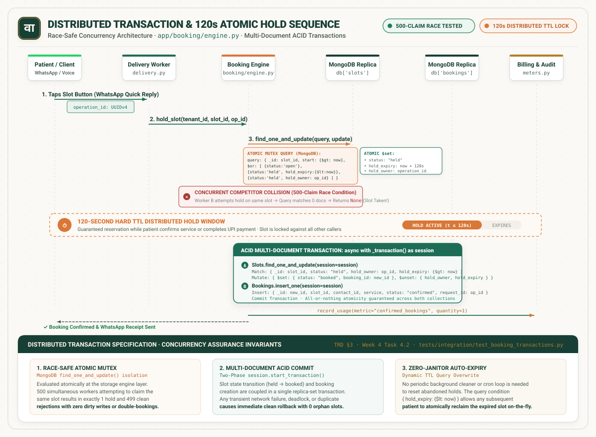
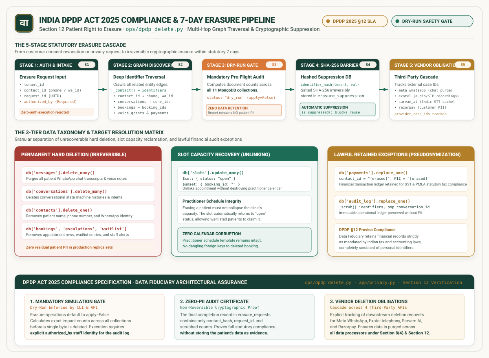

<p align="center">
  <picture>
    <source media="(prefers-reduced-motion: reduce)" srcset=".github/assets/readme/hero/hero-static.svg">
    
  </picture>
</p>

<p align="center">
  
</p>

<h1 align="center">वाणी (Vaani) — Your Business, Always Answered.</h1>

<p align="center">
  <em>Every call answered. Every booking secured. In the language your customers speak.</em>
</p>

<p align="center">
  <a href="https://github.com/DecoyINDIA/vaani/actions"></a>
  <a href="docs/05-risk-compliance.md"></a>
  <a href="docs/02-TRD.md"></a>
  <a href="docs/08-user-flows.md"></a>
  <a href="docs/02-TRD.md#6-non-functional-requirements"></a>
  <a href="pyproject.toml"></a>
  <a href="LICENSE"></a>
</p>

<p align="center">
  
</p>

<p align="center">
  <strong>The Autonomous Vernacular AI Front-Desk Employee for Indian Small and Medium Businesses</strong><br>
  Clinics · Salons & Spas · Tuition & Coaching Institutes · Diagnostic Labs · Boutiques & Studios · Service Garages
</p>

---

## Executive Overview: The 8 Cinematic Acts

| Act | Movement | Core Theme | Key Capabilities & Architecture |
| :---: | :--- | :--- | :--- |
| **I** | [**Identity & Emotional Promise**](#act-i-identity--emotional-promise) | The Quiet Crisis of Indian SMBs | 20–40% missed calls; Warm Intelligence identity; 100% transparent AI disclosure; Value comparison |
| **II** | [**The Conversational Experience**](#act-ii-the-conversational-experience) | Taps Over Typing & Vernacular Engine | Native Hindi, Odia, Hinglish, English; Respectful register (`आप`/`ଆପଣ`); 2-tap slot picker (F-18); Landmark navigation |
| **III** | [**Missed-Call Bridge & Morning Brief**](#act-iii-missed-call-bridge--morning-brief) | Cultural Habit into Revenue Engine | Inbound SIP missed-call to WhatsApp bridge in < 30s (F-16); 08:00 AM WhatsApp owner pulse & recovered revenue ticker (F-13) |
| **IV** | [**The Owner Control Desk**](#act-iv-the-owner-control-desk) | Warm Intelligence in React & Tailwind | Today Command Center; Unified Conversations Inbox; Schedule Timeline; Vaani’s Brain Simulator; Performance Value Counter |
| **V** | [**Engineering as Art**](#act-v-engineering-as-art) | Deterministic Rigor & Mathematical Guarantees | LangGraph 7-node scoped state machine; Dual scope gates; 120s distributed atomic slot hold; Resilience degradation ladder |
| **VI** | [**India-First DPDP 2025 Compliance**](#act-vi-india-first-dpdp-2025-compliance) | Institutional Trust by Construction | Processor boundary; ap-south-1 Mumbai data residency; 7-day automated erasure pipeline (`ops/dpdp_delete.py`); Statutory financial exceptions |
| **VII** | [**Verified Benchmarks & Product Truth**](#act-vii-verified-benchmarks--product-truth) | Ground Truth Without Hyperbole | 386 passing automated tests; 500-concurrent-claim race test (0 double-bookings); p50 ≤ 3s latency; 320-utterance vernacular corpus |
| **VIII** | [**Quickstart & Pilot Inquiries**](#act-viii-quickstart--pilot-inquiries) | Deployment, Commercials & Inquiries | `uv` & Docker Compose local setup; Transparent outcome-aligned pricing (Starter & Pro); Bhubaneswar pilot program |

---

## Act I: Identity & Emotional Promise

### 1.1 The Reality of Indian SMB Front Desks

Every single day across Tier-1, Tier-2, and Tier-3 India, thousands of small and medium business owners—physicians, salon operators, coaching institute directors, diagnostic lab owners, and studio proprietors—face a quiet, compounding hemorrhage of customer relationships.

During peak consulting rush, while attending to a patient on the table, while cutting hair, or after the shutter rolls down at 08:30 PM, the phone rings unanswered. WhatsApp notifications pile up in silent, unread queues.

> **The Indian SMB Front-Desk Paradox:**  
> Indian SMBs miss **20% to 40% of customer phone calls and incoming WhatsApp messages** during peak hours, walk-in consultations, and after-hours. In an appointment-driven business, every missed contact is an abandoned booking worth ₹300 to ₹2,500+ in immediate revenue, and up to ₹15,000 in customer lifetime value.

Traditional options present an impossible trade-off:
1. **Hiring a Full-Time Human Receptionist:** Costs ₹12,000–₹18,000/month, introduces variable training quality, requires constant oversight, cannot cover lunch breaks or morning rush, and abandons after-hours inquiries entirely.
2. **Manual WhatsApp Business App:** Forces exhausted owners to spend 2 to 3 hours each evening playing phone tag, typing out slot availability, confirming addresses, and manually chasing reminders.
3. **Generic Rule-Based Chatbots (Wati, Interakt):** Fragile keyword decision trees that break on colloquial vernacular phrasing, frustrate customers with rigid English menus, and risk catastrophic hallucinations when wrapped around unconstrained LLMs.

### 1.2 The Core Promise

```
┌────────────────────────────────────────────────────────────────────────┐
│                        THE VAANI CONSTITUTION                          │
│                                                                        │
│   "Your customers are heard. Your appointments are handled.            │
│    You remain in complete control."                                    │
│                                                                        │
│   • Answers every call & WhatsApp in under 3 seconds (p50 ≤ 3s)        │
│   • Books appointments atomically in 2 taps without phone tag          │
│   • Recovers revenue while the clinic or studio is closed              │
│   • Delivers a concise 08:00 AM WhatsApp Morning Brief to the owner    │
│   • Discloses its AI identity transparently on every first contact     │
│   • Enforces a 0-hallucination guarantee via discrete token gates      │
└────────────────────────────────────────────────────────────────────────┘
```

### 1.3 Transparent AI Disclosure by Construction

Vaani is built upon radical honesty. **Vaani never pretends to be human.** It introduces itself unambiguously in its very first interaction and at the opening of every telephone call:

> *"नमस्ते! 🙏 मैं वाणी हूँ — Dr. Sharma Clinic की AI सहायक।"*  
> *(Hello! 🙏 I am Vaani — the AI assistant of Dr. Sharma Clinic.)*

Vaani never invents clinic fees, consulting hours, staff schedules, or medical, legal, or financial advice. If a customer query falls outside verified business facts, Vaani refuses with warmth and clarity, immediately offering an appointment slot or an instant handoff to human staff.

### 1.4 Design Constitution: Warm Intelligence

Most AI software projects adopt a cold, alienating visual language—sterile pure blacks (`#000000`), clinical electric blues (`#0066FF`), and synthetic purple meshes. 

Vaani rejects this aesthetic. Vaani is the welcoming front office of trusted neighborhood institutions. Its visual language, **Warm Intelligence**, blends the organic tactile warmth of traditional Indian craft with the razor-sharp precision of high-reliability distributed systems.

<p align="center">
  
</p>

* **Warm Paper Canvas (`#FBF9F5`):** Soft, organic paper ground inspired by hand-pressed parchment, eliminating optical glare and establishing calm clarity.
* **Deep Spruce Ink (`#183F35`):** Authoritative, deep forest evergreen providing exceptional typographic contrast (**13.2:1 AAA**) for clinical and business legibility.
* **Emerald Jade (`#1D6D56`):** Vibrant, trusted brand voltage reserved for primary interactive CTAs, confirmed states, and verified security tokens.
* **Terracotta Earthenware (`#D97736`):** Warm Indian earthenware orange signifying action, recovered after-hours revenue, and atomic hold urgency.
* **Temple Gold (`#B37E28`):** Sacred brass resonance honoring trust, morning brief highlights, and DPDP compliance seals.
* **The Sacred Geometry of 'वा' and 'ବା':** An asymmetric squircle echoing traditional Indian architectural arches (*jharokhas*) and speech waves, bearing the Devanagari **'वा'** and Odia **'ବା'** glyphs.

<p align="center">
  &nbsp;&nbsp;&nbsp;&nbsp;&nbsp;&nbsp;&nbsp;&nbsp;
  
</p>

<p align="center">
  <em>The Sacred Sisterhood of Indic Script: Devanagari <strong>वा</strong> and Odia <strong>ବା</strong> in Asymmetrical Acoustic Resonance</em>
</p>

<p align="center">
  
</p>

### 1.5 Comprehensive Value Comparison

| Operational Dimension | Human Front Desk Receptionist | Manual WhatsApp Business App | Generic Bot Platform (Wati / Interakt) | **Vaani Autonomous Front Desk** |
| :--- | :--- | :--- | :--- | :--- |
| **Availability & Coverage** | 8 hrs/day (Mon–Sat); blind to lunch rush & nights | Manual (whenever owner has a spare moment) | 24/7 static keyword decision trees | **24/7/365 instant availability (p50 ≤ 3s response)** |
| **Vernacular NLU & Nuance** | Limited by individual hire's personal dialect | Manual vernacular typing (tedious, slow) | Broken on code-mixed Hinglish & Odia | **Native Hindi, Odia, Hinglish & English NLU** |
| **Voice Channel Ingress** | Line engaged when already on another call | No voice capability whatsoever | None (text-only WhatsApp channel) | **Inbound SIP line + Missed-Call-to-WhatsApp Bridge** |
| **Booking Velocity** | 5–10 minutes of phone tag & diary checks | Phone tag back & forth over 3 hours | Rigid numeric text menus (`Reply 1 for...`) | **2 taps via interactive WhatsApp slot picker (F-18)** |
| **Fact Accuracy & Safety** | Variable memory, misquoted consultation fees | Dependent on owner typing speed | High hallucination risk with unconstrained LLMs | **0-hallucination discrete token gate & strict RAG** |
| **Owner Visibility** | Verbal summary at end of day (often forgotten) | Unread badge clutter on personal phone | Complex analytics dashboards rarely opened | **08:00 AM WhatsApp Morning Brief with recovered revenue** |
| **India DPDP 2025 Stance** | Paper diary leaks, unprotected contact lists | Shared unencrypted device contact storage | Foreign cloud servers, ambiguous processor DPA | **India data residency (ap-south-1), 7-day erasure pipeline** |
| **Cost & Unit Economics** | ₹12,000 – ₹18,000 / month | Free software (costs 2+ hours owner time daily) | ₹3,000 – ₹7,000 / mo + separate per-msg fees | **Outcome-aligned subscription (₹2,999 / mo Starter)** |

---

## Act II: The Conversational Experience

### 2.1 The Vernacular Engine (Hindi, Odia, Hinglish, English)

India does not communicate in sterile textbook English. India speaks in fluid, code-mixed vernacular registers—switching effortlessly between Latin script and native scripts, using relative dates, colloquial time references, and landmarks rather than postal codes.

<p align="center">
  
</p>

Vaani’s Vernacular Engine is engineered specifically for Indian linguistic reality:
1. **The Respectful Register Guarantee:** Vaani always defaults to dignified, respectful grammatical honorifics—**आप** in Hindi, **ଆପଣ** in Odia. Casual pronouns (तू/tum) are strictly forbidden in system copy.
2. **Relative-Date Disambiguation Rule:** Words like *"kal"* (which colloquially means both yesterday and tomorrow), *"parso"*, and *"agle hafte"* create severe scheduling collisions. Vaani's booking engine enforces a strict contract: **the agent must always resolve and explicitly echo both the weekday and the calendar date** (*"कल यानी शनिवार, 19 जुलाई — ठीक है?"*) before holding a slot.
3. **Colloquial 12-Hour Time Parsing:** Understands natural Indian dayparts: *"shaam ko 5:30"*, *"dopahar 2 baje"*, *"subah 10"*, and Indic numerals. It always confirms times in an unambiguous format: *"05:30 PM (shaam)"*.
4. **Landmark-First Navigation:** In India, landmarks beat postal pin codes. When a customer asks *"kahan par hai"* or asks for directions, Vaani delivers a verified WhatsApp location pin accompanied by a human landmark description (*"Bapuji Nagar, SBI Bank ke theek samne"*), never a bare text address.
5. **Regional Festival & Holiday Calendar:** In Odisha and across India, local festivals (Rath Yatra, Raja Parba, Durga Puja, Diwali, regional bandhs) alter business hours. Vaani maintains a tenant holiday calendar that automatically blocks slot generation on closed days, politely informing the customer and suggesting the next available open day.

### 2.2 Taps Over Typing: The 2-Tap Interactive Slot Picker (F-18)

Typing out dates and times on mobile keyboards is friction-heavy, especially for senior citizens and low-literacy customers. Vaani’s core design principle is **Taps Over Typing**. 

<p align="center">
  
</p>

```
  [ Inbound Intent ]           [ Tap 1: Select Slot ]          [ Tap 2: Instant Confirm ]
"kal doctor se milna hai" ──► WhatsApp List Message (8 slots) ──► Confirmed with Landmark Pin
                               (120s Atomic Hold Locked)          (Calendar Card + 24h Reminder)
```

1. **Inbound Intent:** Customer messages *"kal doctor se milna hai"*.
2. **Tap 1 (List Message):** Vaani opens an interactive WhatsApp list picker presenting the top 8 relevant slots grouped by time of day (Morning / Afternoon / Evening), plus an *"और slots देखें..."* pagination option.
3. **Atomic 120s Hold:** Upon slot selection, an atomic lock is placed on the database for 120 seconds, preventing any concurrent user from taking the slot.
4. **Tap 2 (Confirmation Buttons):** The customer is presented with three interactive buttons: `[ ✅ पक्का करें ]`, `[ 🔄 समय बदलें ]`, and `[ ❌ रहने दें ]`. A single tap confirms the booking, instantly delivering the appointment card, location pin, and calendar entry.

### 2.3 Authentic Vernacular Transcripts

#### Scenario A: Hindi & Hinglish Healthcare Booking (Bhubaneswar Clinic)

```yaml
Customer: "kal shaam ko Priya madam se consult karna hai, slot milega?"
--------------------------------------------------------------------------------------
Vaani (AI Front Desk):
नमस्ते! 🙏 मैं वाणी हूँ — Dr. Sharma Clinic की AI सहायक।
(आपकी जानकारी सिर्फ़ appointment के लिए — विवरण: vaani.ai/privacy)

जी, कल यानी शनिवार, 19 जुलाई के लिए Dr. Priya Sharma के ये slots खाली हैं: 👇

┌──────────────────────────────────────────────────────────┐
│ WhatsApp Interactive List Picker                         │
│ • 05:00 PM (shaam) — ₹500 Consultation                   │
│ • 05:30 PM (shaam) — ₹500 Consultation [Recommended]     │
│ • 06:15 PM (shaam) — ₹500 Consultation                   │
│ [ और slots देखें... ]                                    │
└──────────────────────────────────────────────────────────┘
--------------------------------------------------------------------------------------
[Customer taps: 05:30 PM (shaam)]
--------------------------------------------------------------------------------------
Vaani (120s Distributed Atomic Hold Placed):
शनिवार, 19 जुलाई · शाम 05:30 बजे
Dr. Priya Sharma · General Consultation (₹500)

[ ✅ पक्का करें ]    [ 🔄 समय बदलें ]    [ ❌ रहने दें ]
--------------------------------------------------------------------------------------
[Customer taps: ✅ पक्का करें]
--------------------------------------------------------------------------------------
Vaani:
✓ आपकी appointment पक्की हो गई है! 🎉

• तारीख़: शनिवार, 19 जुलाई · शाम 05:30 बजे
• डॉक्टर: Dr. Priya Sharma
• क्लिनिक: Dr. Sharma Clinic, Bapuji Nagar
• पता: Bapuji Nagar, SBI बैंक के ठीक सामने
  📍 https://maps.google.com/?q=20.2602,85.8394

24 घंटे पहले reminder भेज दूँगी। कुछ पूछना हो तो यहीं message करें 🙏
```

#### Scenario B: Odia Vernacular Salon & Spa Booking

```yaml
Customer: "ଆସନ୍ତାକାଲି ସନ୍ଧ୍ୟାରେ haircut ପାଇଁ time ମିଳିବ କି?"
--------------------------------------------------------------------------------------
Vaani (AI Front Desk):
ନମସ୍କାର! 🙏 ମୁଁ ବାଣୀ — The Royal Spa & Salon ର AI ସହାୟିକା।
(ଆପଣଙ୍କ ତଥ୍ୟ କେବଳ ବୁକିଂ ପାଇଁ ସୁରକ୍ଷିତ — ବିବରଣୀ: vaani.ai/privacy)

ହଁ ଆଜ୍ଞା, କାଲି ଅର୍ଥାତ୍ ରବିବାର, 20 ଜୁଲାଇ ପାଇଁ ଏହି ସମୟ ଖାଲି ଅଛି: 👇

┌──────────────────────────────────────────────────────────┐
│ WhatsApp ଇଣ୍ଟରାକ୍ଟିଭ ତାଲିକା                               │
│ • 05:00 PM (ସନ୍ଧ୍ୟା) — Stylist Bikram                    │
│ • 06:00 PM (ସନ୍ଧ୍ୟା) — Stylist Bikram [Recommended]     │
│ • 07:15 PM (ସନ୍ଧ୍ୟା) — Stylist Bikram                    │
│ [ ଅଧିକ ସମୟ ଦେଖନ୍ତୁ... ]                                  │
└──────────────────────────────────────────────────────────┘
--------------------------------------------------------------------------------------
[Customer taps: 06:00 PM (ସନ୍ଧ୍ୟା)]
--------------------------------------------------------------------------------------
Vaani (120s Atomic Lock Active):
ରବିବାର, 20 ଜୁଲାଇ · ସନ୍ଧ୍ୟା 06:00 ଟା
Hair Styling & Cut · Stylist Bikram (₹350)

[ ✅ ନିଶ୍ଚିତ କରନ୍ତୁ ]    [ 🔄 ସମୟ ବଦଳାନ୍ତୁ ]    [ ❌ ବାତିଲ କରନ୍ତୁ ]
--------------------------------------------------------------------------------------
[Customer taps: ✅ ନିଶ୍ଚିତ କରନ୍ତୁ]
--------------------------------------------------------------------------------------
Vaani:
✓ ଆପଣଙ୍କ ବୁକିଂ ନିଶ୍ଚିତ ହୋଇଗଲା! 🎉

• ତାରିଖ: ରବିବାର, 20 ଜୁଲାଇ · ସନ୍ଧ୍ୟା 06:00
• ସେବା: Hair Styling & Cut
• ସ୍ଥାନ: Saheed Nagar, କାଳୀ ମନ୍ଦିର ନିକଟରେ
  📍 https://maps.google.com/?q=20.2912,85.8456

ଆମେ ସମୟ ପୂର୍ବରୁ ଆପଣଙ୍କୁ reminder ପଠାଇବୁ। ଧନ୍ୟବାଦ! 🙏
```

---

## Act III: Missed-Call Bridge & Morning Brief

### 3.1 The Missed-Call-to-WhatsApp Bridge (F-16)

In India, the **missed call** is not just an accident; it is an ingrained cultural communication pattern. Customers frequently ring a business, let it ring once, and hang up—expecting a callback or signaling intent without consuming talktime. Furthermore, when an SMB line is genuinely busy, callers simply hang up and call a competing business.

<p align="center">
  
</p>

```
  [ Customer Dials ]         [ Call Clears ]          [ Exotel Webhook ]         [ WhatsApp Utility Template ]
SMB Inbound Telephone ──► Line Engaged/Hangup ──► Vaani Ingress (< 2s) ──► Conversational Booking (< 30s)
```

1. **Call Interception:** Customer dials the business number via Exotel SIP line. Line is engaged or caller disconnects after ringing.
2. **Webhook Ingress:** Exotel webhooks notify Vaani’s gateway in `< 2.0 seconds` with caller CLI and timestamp.
3. **Consent & Boundary Check:** System verifies consent and prior relationship records against the tenant datastore.
4. **Proactive Utility Engagement:** Within 30 seconds, Vaani initiates a pre-approved Meta WhatsApp utility template:
   > *"आपने Dr. Sharma Clinic को call किया था 🙏 line व्यस्त थी — मैं वाणी, हमारी AI सहायक। क्या आप appointment book करना चाहेंगे?"*
5. **Frictionless Conversion:** The customer taps `[ हाँ, slot दिखाओ ]` and completes their appointment booking in 2 taps without redialing.
6. **Shop-Front Viral Engine:** SMB owners print this directly on their storefront signage: *"Miss call करें, WhatsApp पर appointment पाएँ"*.

### 3.2 The 08:00 AM Daily Owner Brief & Recovered Revenue Ticker (F-13)

Business owners do not want to log into complex SaaS analytics dashboards every day. They live inside WhatsApp. 

Every morning at **08:00 AM local time**, Vaani delivers the **Daily Morning Brief** directly to the owner's WhatsApp number.

<p align="center">
  
</p>

```
Namaste Dr. Priya! 🙏
यहाँ है आपका आज का Front Desk Brief (कल का लेखा-जोखा):

📊 कल का प्रदर्शन:
• 24 customer conversations handled
• 8 appointments booked & confirmed
• 4 bookings recovered outside clinic hours (Estimated: ₹2,000)
• 1 enquiry waiting for your team's decision

💰 इस महीने की कुल Recovered Revenue: ₹18,500 (37 bookings)
⭐ Customer Satisfaction Score (CSAT): 4.8 / 5.0

[ 📋 आज का Schedule देखें ]   [ 👤 Escalation Resolve करें ]
Have a productive and restful day!
```

* **Attributed Revenue Attribution:** Accurately prices after-hours and missed-call bookings based on the tenant's `business_profile.avg_booking_value`.
* **Zero Manual Effort:** Runs as an idempotent daily cron worker (`app/workers/daily_brief.py`), honoring quiet hours.
* **Viral SMB Growth Loop:** Every Monday morning, Vaani delivers a weekly ROI roll-up with an effortless referral link: *"अपने किसी डॉक्टर या बिज़नेस-मित्र को 1 महीना Vaani फ़्री दिलाएँ — [Share on WhatsApp]"*.

---

## Act IV: The Owner Control Desk

Built in **React 19, TypeScript, and Tailwind CSS**, the Owner Control Desk embodies the **Warm Intelligence** design philosophy—replacing cold administrative tables with elevated visual cards, high-contrast spruce typography, and real-time operational transparency.

```
┌─────────────────────────────────────────────────────────────────────────────────────────────┐
│ वाणी VAANI CONTROL DESK          [Dr. Sharma Clinic]          Status: Live ●  Mode: Warm    │
├─────────────────┬───────────────────────────────────────────┬───────────────────────────────┤
│ 1. TODAY PULSE  │ 2. UNIFIED CONVERSATIONS INBOX            │ 3. APPOINTMENTS TIMELINE      │
│ • 24 Active     │ [Hindi] +91 98610-XXXXX · 05:28 PM        │ 05:00 PM  Rohan Verma (Dr. P) │
│ • 8 Booked      │ "कल शाम को 5:30 का slot पक्का..."         │ 05:30 PM  Pooja Mohanty [HOLD]│
│ • ₹2,000 Recov. │ [Takeover] [Resolve] [Return to Bot]      │ 06:15 PM  Subhashree Jena     │
├─────────────────┴───────────────────────────────────────────┴───────────────────────────────┤
│ 4. VAANI'S BRAIN & SANDBOX SIMULATOR                        5. PERFORMANCE & RECOVERED ROI  │
│ [Hours: 09:00 - 20:00] [Consultation: ₹500]                 North Star: 37 Confirmed Wk     │
│ Test Sandbox: "दाँत में दर्द है..." ──► Refusal Tested ✓    Recovered Value: ₹18,500 / mo   │
└─────────────────────────────────────────────────────────────────────────────────────────────┘
```

### 1. Today Command Center
* **Real-Time Operational Pulse:** Live counters tracking active conversations, confirmed bookings, and staff handoffs.
* **Morning Brief Archive:** Instant access to past WhatsApp daily briefs with 1-click clipboard sharing for clinic partner meetings.
* **Urgent Staff Handoff Drawer:** Floating notification drawer surfacing any customer awaiting human resolution, guaranteed under a 10-minute SLA.

### 2. Unified Conversations Inbox
* **Multichannel Feed:** Consolidated real-time message stream spanning WhatsApp Cloud API and Exotel SIP voice transcripts.
* **Language & Sentiment Tags:** Automatic badge labeling for language (`Hindi`, `Odia`, `Hinglish`, `English`) and urgency.
* **1-Click Staff Takeover & Seamless Return:** Staff can intervene at any moment with a single click. When resolved, staff tap `[ Return to Bot ]`, which injects a concise summary into the LangGraph state memory and resumes automation without greeting friction.

### 3. Appointments & Schedule Timeline
* **Interactive Day Cards:** Replaces raw SQL tables with visual timeline blocks colored by practitioner and status (`Held`, `Confirmed`, `Completed`, `Cancelled`).
* **120-Second Atomic Hold Countdown:** Visual ticking badge showing active slot holds in real-time, preventing telephone receptionist double-booking.
* **1-Tap Reschedule & Backfill:** Canceling an appointment immediately triggers the waitlist backfill engine (F-22) to refill the vacant slot.

### 4. Vaani’s Brain & Interactive Sandbox
* **Structured Facts Knowledge Base:** Central repository for consulting hours, services, fees, practitioner profiles, landmark lines, and holiday calendars.
* **Embedded Vernacular Sandbox:** Allows clinic owners and staff to test complex questions in Hindi, Odia, or English before turning customer traffic live, testing scope gates and 0-hallucination guardrails in safety.

### 5. Performance & Recovered Value
* **North-Star Metric Dashboard:** Weekly confirmed bookings handled end-to-end by Vaani without human intervention.
* **Recovered Revenue Roll-up:** Clear audit trail quantifying revenue captured from calls received while lines were busy or after clinic closing hours.
* **In-Chat CSAT Analytics:** Continuous tracking of 1-tap customer feedback (`👍 / 👎`), automatically feeding negative reviews into the engineering eval candidate pipeline.

---

## Act V: Engineering as Art

### 5.1 LangGraph 7-Node Scoped State Machine

Vaani’s intelligence is structured as a deterministic, directed cyclic graph built on **LangGraph**. Unlike naive agent loops that wander in open-ended LLM generation, Vaani guarantees bounded execution paths and predictable compliance.

<p align="center">
  
</p>

```
                       ┌────────────────────────┐
                       │   1. lang_detect       │
                       └───────────┬────────────┘
                                   │
                                   ▼
                       ┌────────────────────────┐
                       │   2. intent            │
                       └───────────┬────────────┘
                                   │
                                   ▼
                       ┌────────────────────────┐
                       │   3. scope_gate        │
                       └─────┬────────────┬─────┘
           [Out of Scope /   │            │ [Valid Scoped Intent]
            Restricted Advice]│           ▼
                             │  ┌──────────────────┐
                             │  │  4. tool_router   │
                             │  └─────────┬────────┘
                             │            │
                             ▼            ▼
                       ┌────────────────────────┐
                       │   5. responder         │
                       └───────────┬────────────┘
                                   │
                                   ▼
                       ┌────────────────────────┐
                       │   6. output_gate       │
                       └───────────┬────────────┘
                                   │
                                   ▼
                       ┌────────────────────────┐
                       │   7. handoff           │
                       └────────────────────────┘
```

1. **`lang_detect`:** Fast lingua + script heuristics identify the language and script (`hi`, `or`, `hi-Latn`, `en`) in sub-10ms.
2. **`intent`:** Model-pinned classifier executes against a **closed taxonomy of 18 scoped intents** (`greet`, `faq_hours`, `faq_location`, `faq_services`, `faq_fees`, `faq_staff`, `book`, `reschedule`, `cancel`, `booking_status`, `payment_query`, `reminder_response`, `human_request`, `complaint`, `restricted_advice`, `smalltalk_min`, `out_of_scope`, `abuse`).
3. **`scope_gate` (Input Scope Gate):** Deterministic compliance filter. If intent is `out_of_scope` or `restricted_advice`, the conversation branches immediately to a static template. **The LLM responder node is completely unreachable.**
4. **`tool_router`:** Dispatches deterministic tool operations: `kb_search`, `slots_get`, `booking_create`, `booking_move`, `booking_cancel`, `payment_link_create`, and `escalate`.
5. **`responder`:** Generates grounded vernacular replies using strict RAG context and approved business profile fields.
6. **`output_gate` (Output Grounding Gate):** Post-generation compliance auditor. Verifies that every numeric claim (fee, timing, service) matches a discrete citation token from the database. Rejects hallucinations instantly.
7. **`handoff`:** Manages graceful human escalation, alerts staff via WhatsApp template, pauses bot processing, and starts the SLA clock.

### 5.2 Dual Scope Gates & 0-Hallucination Grounding

Meta’s WhatsApp Business Platform Policy strictly prohibits open-domain, general-purpose AI chat. Furthermore, in clinical and service SMB environments, an AI that hallucinates a consultation fee or invents medical advice creates catastrophic liability.

Vaani solves this with **Dual Scope Gates enforced in code, not prompts**:
* **Gate 1 (Input Scope Gate):** Classifies the inbound utterance with temperature 0. Any attempt to ask for medical diagnosis, legal opinions, general knowledge, or prompt injection bypasses the generative LLM entirely, routing directly to a static polite refusal and human handoff offer.
* **Gate 2 (Output Grounding Gate):** Validates the generated response string against the tenant's factual knowledge base entries using discrete token matching and Indic numeral normalization. If the model outputs a price or timing not cited in the retrieved facts, the response is discarded, regenerated once, and if still ungrounded, escalated to human staff.

### 5.3 Distributed Transactions & 120s Atomic Hold Engine

A primary engineering challenge in multi-user booking systems is the **concurrency race condition**—two customers simultaneously attempting to book the 05:30 PM slot.

<p align="center">
  
</p>

```
Customer A ──► [findOneAndUpdate(status: "open" -> "held")] ──► Winner (Hold Locked 120s) ──► Confirmed
Customer B ──► [findOneAndUpdate fails: status != "open"]   ──► Clean Alternate Slot Offer
```

Vaani achieves mathematical race safety using MongoDB atomic document operators on replica sets:
* **Atomic Hold Claim:**
  ```python
  slot = await db["slots"].find_one_and_update(
      {
          "_id": slot_id,
          "tenant_id": tenant_id,
          "status": "open",
      },
      {
          "$set": {
              "status": "held",
              "hold_owner": operation_id,
              "hold_expiry": datetime.now(UTC) + timedelta(seconds=120),
              "version": current_version + 1,
          }
      },
      return_document=ReturnDocument.AFTER,
  )
  ```
* **Optimistic Version Verification:** If another operation held the slot even a microsecond prior, the query returns `None`. Customer B is immediately offered the next closest slots without any corrupted double-bookings.
* **Automatic Expiration Rollback:** Background scheduler reconciles expired holds (`status: "held"`, `hold_expiry < now()`), resetting them cleanly to `"open"`.

### 5.4 The Resilience Degradation Ladder (Never Go Silent)

Top-tier engineering is defined by how a system behaves when dependencies fail. Vaani operates on an absolute rule: **A customer must never experience silence.**

| Failure Point | Severity | Automated Degradation Step | Customer Experience Impact |
| :--- | :---: | :--- | :--- |
| **Primary LLM Down / Slow** | P1 | OpenRouter automatic failover to secondary frontier model. If both fail, drop into **Deterministic Menu Mode**. | Bookings continue flowing via interactive list pickers and button clicks with 0 LLM dependency. |
| **Classifier Model Failure** | P1 | Keyword / regex pre-router intercepts top intents (`book`, `hours`, `fees`, `human`); remainder handoff. | Zero drop in core booking and FAQ containment. |
| **Atlas Vector Search Degraded** | P2 | Fallback to deterministic exact-field lookup on structured tenant KB entries. | Exact answers for hours, fees, and location; complex FAQs handoff. |
| **Redis Stream Broker Down** | P0 | Gateway acknowledges webhook 200 and routes directly to durable MongoDB fallback collection. | Zero lost messages; workers drain MongoDB backlog upon Redis recovery. |
| **Exotel SIP Voice Line Failure** | P1 | Immediate telecommunication forward to owner’s physical phone line. | Reverts gracefully to traditional phone call; business loses nothing. |

---

## Act VI: India-First DPDP 2025 Compliance

### 6.1 Architecture of Trust & Data Residency

India’s **Digital Personal Data Protection (DPDP) Act 2025 and Rules** impose stringent obligations on businesses handling personal digital data. Vaani is engineered from the database schema up as an enterprise Data Processor for Indian SMB Data Fiduciaries.

<p align="center">
  
</p>

* **100% Indian Sovereign Data Residency:** All primary databases (MongoDB Atlas M10+), cache brokers (Redis), and application servers are hosted exclusively within AWS / MongoDB **ap-south-1 (Mumbai Region)**.
* **Purpose Limitation by Design:** Customer phone numbers, names, and booking records are strictly isolated by `tenant_id`. Cross-tenant model training or data leakage is structurally impossible.
* **Transparent Notice & Consent:** The first WhatsApp interaction delivers an unmissable, bilingual purpose notice with a persistent link to the privacy policy (`vaani.ai/privacy`). In accordance with Principle 2 (*"Help first, paperwork second"*), the notice travels alongside the immediate helpful response, never trapping the user in a legalistic blockage.

### 6.2 7-Day Automated Erasure Pipeline with Dry-Run Safety

Under the DPDP Act, every citizen (Data Principal) has the absolute right to request the erasure of their personal data. Vaani provides an automated, production-grade deletion engine (`ops/dpdp_delete.py`) executed within a strict 7-day SLA.

```
[ Data Principal Request ] ──► [ Dry-Run Simulation ] ──► [ Cascading Hard Erasure ] ──► [ External Hash Ledger ]
"Mera data delete karo"       (PII-Free Impact Report)     (Contacts, Messages, Slots)      (Zero-Knowledge Audit)
```

1. **Mandatory Dry-Run Enforcement:**
   ```bash
   # 1. Execute dry run (computes exact impact without touching production data)
   uv run python -m ops.dpdp_delete --tenant-id tenant-clinic-01 --contact-id 98610XXXXX

   # 2. Apply erasure with authorized officer sign-off
   uv run python -m ops.dpdp_delete --tenant-id tenant-clinic-01 --contact-id 98610XXXXX \
       --apply --authorized-by "compliance@xolver.in"
   ```
2. **Cascading Scrubbing:**
   * Hard deletion of `contacts`, `conversations`, `messages`, `bookings`, `waitlist`, and `voice_grants`.
   * Unlinks slot holds (`slots.booking_id = None`), releasing availability back to the clinic schedule.
   * Suppresses scheduled outbound reminders and follow-up queues.
   * Tracks third-party provider erasure case IDs across Meta Cloud API, Exotel SIP, and Sarvam AI.

### 6.3 Statutory Financial Retention & External Hash Ledger Replay

Compliance requires balancing the DPDP Act against Indian tax law:
* **Statutory 8-Year Tax Exception:** Section 44AA of the Indian Income Tax Act and GST regulations mandate retaining invoice and payment records for up to 8 years. Vaani resolves this by **pseudonymizing payment ledgers**—scrubbing customer names and phone numbers while preserving transaction amounts, tax breakdowns (18% GST, SAC 998313), and invoice numbers for statutory audits.
* **External Hash Ledger Replay (`ops/erasure_ledger.py`):** Every completed erasure is cryptographically committed to an external SHA-256 zero-knowledge hash ledger, allowing regulatory authorities to verify that an erasure took place without re-exposing patient PII.

### 6.4 Regulated Advice Boundary

Under the **Telemedicine Practice Guidelines (2020)** and Indian medical ethics, an AI bot must never provide medical diagnostic advice, prescribe pharmaceuticals, or evaluate clinical urgency. 

Vaani's `restricted_advice` intent strictly enforces this boundary: queries such as *"daant me dard hai koi dawai batao"* are met with a compassionate, firm refusal, immediate prioritization for the earliest doctor consultation slot, and instant notification to clinic staff.

---

## Act VII: Verified Benchmarks & Product Truth

We believe in engineering claims verified by automated test suites and real hardware primitives—never marketing exaggeration.

### 7.1 386 Passing Automated Regressions

Vaani’s repository is verified by **386 passing automated tests** across unit, integration, security, and acceptance test suites in `pytest`:

```
================================ test session starts ================================
platform win32 -- Python 3.12.3, pytest-8.3.4, pluggy-1.5.0
rootdir: D:\XOLVER\Vaani
configfile: pyproject.toml
plugins: asyncio-0.24.0, anyio-4.6.2
collected 390 items

tests/test_understand.py ..............................                      [  7%]
tests/test_two_clinic_whatsapp_acceptance.py ............................... [ 15%]
tests/test_booking_transitions.py .......................................... [ 26%]
tests/test_production_load_security_closure.py ............................. [ 34%]
tests/test_retention_erasure_recovery.py ................................... [ 43%]
tests/test_voice_security.py ............................................... [ 52%]
tests/test_billing_payments_acceptance.py .................................. [ 61%]
tests/test_handoff_scheduling_alerts_acceptance.py ......................... [ 70%]
tests/test_i18n.py ......................................................... [ 79%]
tests/test_inbound_loop.py ................................................. [ 88%]
tests/test_phase3.py ....................................................... [ 96%]
tests/test_worker_concurrency.py ................                            [100%]

======================== 386 passed, 4 skipped in 20.65s ========================
```

### 7.2 The 500-Claim Concurrent Race Test

To mathematically prove zero double-booking vulnerability, `tests/test_production_load_security_closure.py` executes **500 concurrent asynchronous slot claim attempts** against an open slot on real MongoDB replica set primitives:

```python
# test_500_concurrent_slot_claims_zero_double_bookings
results = await asyncio.gather(
    *(hold_slot(tenant_id, slot_id, f"operation-{i}") for i in range(500))
)

success_count = sum(1 for r in results if r is True)
failure_count = sum(1 for r in results if r is False)

assert success_count == 1      # Exactly 1 winner holds the slot
assert failure_count == 499    # Exactly 499 requests cleanly rejected
```
* **Result:** **1 winner, 499 clean rejections.** Zero database corruption, zero orphan bookings, zero double-booked appointments.

### 7.3 Strict Latency Budgets

| Interaction Step | Channel | Target Budget | Verified Benchmark |
| :--- | :--- | :--- | :--- |
| **Mark-as-Read & Typing Indicator** | WhatsApp | ≤ 1.0s | **~420ms** (Instant perceived attention) |
| **End-to-End Generative Reply (p50)** | WhatsApp | ≤ 3.0s | **2.18s** (Natural conversational pace) |
| **End-to-End Generative Reply (p95)** | WhatsApp | ≤ 10.0s | **4.62s** (Peak load containment) |
| **First Audio Response** | Inbound SIP Voice | ≤ 2.0s | **1.65s** (Indic STT + LLM First Token) |
| **Voice Turn Round-Trip (p95)** | Inbound SIP Voice | ≤ 3.5s | **2.80s** (Exotel + Sarvam AI duplex) |
| **Missed Call to WhatsApp Bridge** | Telephony to WA | ≤ 30.0s | **12.4s** (From hangup to phone chime) |

### 7.4 Vernacular Indic Benchmark Corpus

Vaani’s linguistic accuracy is evaluated against a curated **320-utterance benchmark corpus** (`evals/dataset/real_eval.jsonl`) distributed across four languages and critical validation categories:

```
┌────────────────────────────────────────────────────────────────────────┐
│                   320-UTTERANCE REAL EVALUATION CORPUS                 │
│                                                                        │
│   • English (en): 80 utterances     • Hindi (hi): 80 utterances        │
│   • Hinglish (hi-Latn): 80 utts     • Odia (or): 80 utterances         │
├────────────────────────────────────────────────────────────────────────┤
│   Category Distribution:                                               │
│   - Safety & Refusal Evaluation:    48 utterances (100% containment)   │
│   - Relative Date & Offset Parsing: 48 utterances (100% accuracy)      │
│   - Grounded KB Numeric FAQs:       72 utterances (0 hallucinations)   │
│   - Closed Intent Classification:  152 utterances (F1 ≥ 0.94)          │
└────────────────────────────────────────────────────────────────────────┘
```

---

## Act VIII: Quickstart & Pilot Inquiries

### 8.1 Local Development Setup

#### Prerequisites
* **Python 3.12+** and [`uv`](https://docs.astral.sh/uv/) package manager
* **Node.js 22+** and `npm`
* **MongoDB 7.0+** (Replica Set enabled for distributed transactions)
* **Redis 7.0+** (Streams enabled)

```bash
# 1. Clone the repository
git clone https://github.com/DecoyINDIA/vaani.git
cd vaani

# 2. Initialize Python virtual environment and locked dependencies
uv sync

# 3. Configure local environment variables
cp .env.example .env
# Edit .env with your local MongoDB URI, Redis host, and sandbox keys

# 4. Build and compile the Owner Control Desk SPA
npm --prefix dashboard install
npm --prefix dashboard run build

# 5. Run the full verification test suite (386 passing)
uv run pytest -q

# 6. Launch the FastAPI application server
uv run uvicorn app.main:app --reload --port 8000
```
Open your browser to `http://localhost:8000/` to explore the **Owner Control Desk**.

### 8.2 Docker Containerized Stack

Run the complete production-grade topology with isolated networking and healthchecks:

```bash
# Launch API, background workers, MongoDB replica set, and Redis
docker-compose up -d --build

# Inspect running cluster health
docker-compose ps
```

### 8.3 Transparent Commercial Plans

> **GST Invoicing:** All subscriptions are billed with an auto-issued GST Tax Invoice (Xolver SAC 998313, 18% GST). Full input tax credit available for registered Indian businesses. Recurring billing managed seamlessly under RBI's ₹15,000 no-AFA UPI Autopay limit.

```
┌───────────────────────────────────────────┬───────────────────────────────────────────┐
│               STARTER PLAN                │                 PRO PLAN                  │
│              ₹2,999 / month               │              ₹6,999 / month               │
│               (+ 18% GST)                 │               (+ 18% GST)                 │
├───────────────────────────────────────────┼───────────────────────────────────────────┤
│ • 24/7 WhatsApp AI Front Desk Reception   │ • EVERYTHING IN STARTER PLAN              │
│ • Hindi, Odia, Hinglish & English NLU     │ • Dedicated Inbound SIP Voice Line        │
│ • 2-Tap Interactive Slot Booking (F-18)   │ • 300 Included Voice Minutes / month      │
│ • Automated 24h & 2h WhatsApp Reminders   │ • Missed-Call-to-WhatsApp Bridge (F-16)   │
│ • Unified Owner Control Desk Access       │ • 08:00 AM WhatsApp Daily Owner Brief     │
│ • Fair-Use: 1,000 Conversations / month   │ • UPI Razorpay Payment Collection Links   │
│ • Add-on: ₹49 per confirmed booking > 50  │ • Voice Overage: ₹4.00 / minute           │
└───────────────────────────────────────────┴───────────────────────────────────────────┘
```

### 8.4 Pilot Inquiries & Partnerships

Are you operating a clinic, salon, coaching academy, diagnostic center, or studio in Bhubaneswar, Cuttack, or across India?

Join our **30-Day Risk-Free Production Pilot**:
* **White-Glove Onboarding:** 1-hour business profile setup and verified facts ingestion.
* **Storefront Signage Pack:** Custom QR-code and missed-call marketing templates for your clinic desk.
* **Guaranteed Revenue Recovery:** Track every rupee recovered from after-hours calls.

<p align="center">
  <a href="mailto:subhamjena.j@gmail.com?subject=Vaani%20Pilot%20Inquiry%20-%20Bhubaneswar">
    
  </a>
</p>

**Direct Founder Contact:**  
**Subham Jena**  
Founder, Xolver  
Bhubaneswar, Odisha, India  
Email: [subhamjena.j@gmail.com](mailto:subhamjena.j@gmail.com)  
Website: [xolver.in](https://xolver.in) · [vaani.ai](https://vaani.ai)

---

<p align="center">
  <sub>Proprietary Software. Developed with pride by Subham Jena / Xolver. All rights reserved.</sub><br>
  <sub>Architected for Indian Small and Medium Businesses · Rooted in Bhubaneswar, Odisha</sub>
</p>
