<p align="center">
  
</p>

<h1 align="center">Vaani — Your business, always answered.</h1>

<p align="center">
  <em>Every call answered. Every booking secured. In the language your customers speak.</em>
</p>

<p align="center">
  <a href="https://github.com/DecoyINDIA/vaani/actions"></a>
  <a href="05-risk-compliance.md"></a>
  <a href="02-TRD.md#1-architecture-overview"></a>
  <a href="02-TRD.md#42-scope-enforcement-two-gates-both-mandatory"></a>
  <a href="08-user-flows.md"></a>
  <a href="02-TRD.md#3-data-model-mongodb-collections"></a>
  <a href="dashboard/"></a>
  
</p>

<p align="center">
  <strong>The Autonomous Vernacular AI Front Office for Indian Small and Medium Businesses</strong><br>
  <code>Clinics</code> · <code>Salons & Spas</code> · <code>Tuition & Coaching</code> · <code>Diagnostic Labs</code> · <code>Studios</code> · <code>Service Garages</code>
</p>

---

<p align="center">
  
</p>

## The Indian SMB Reality

> **"Your customers are heard. Your appointments are handled. You remain in control."**

In India's bustling towns and Tier-1/2 markets, small and medium business owners miss **20% to 40% of inbound calls and WhatsApp enquiries** every single day. Calls ring out while doctors consult with patients, salon stylists wash hair, coaching faculties teach batches, or after the shutter comes down at 8:00 PM. In high-density local commerce, **an unanswered call is lost revenue handed straight to the competitor across the street.**

Hiring a human receptionist costs **₹12,000 – ₹18,000/month**, covers only 8 daylight hours, creates a single-call bottleneck during peak rush, and struggles with staff turnover. Conversely, generic chatbots (Wati, Interakt, Aisensy) rely on rigid keyword rule-trees, break down on colloquial Hindi and Odia code-switching, hallucinate unauthorized discounts or medical advice, and lack atomic database locks for real-time bookings.

**Vaani solves this autonomously.** Operating over **official WhatsApp Business API** and **telephony SIP lines (Exotel)**, Vaani serves as an always-on, vernacular AI front office employee. It speaks fluent **Hindi (हिन्दी)**, **Odia (ଓଡ଼ିଆ)**, **Hinglish (Latin script)**, and **English**, guides customers through **2-tap slot bookings**, bridges missed calls in under 2 seconds, safeguards business reputation with **0-hallucination dual scope gates**, and delivers an executive **08:00 AM WhatsApp Morning Brief** to the owner with yesterday's pulse and recovered revenue.

---

## How Vaani Compares

| Dimension | Human Front Desk | WhatsApp Business App | Generic Chatbots (Wati / Interakt) | **Vaani Autonomous Desk** |
| :--- | :--- | :--- | :--- | :--- |
| **Availability** | 8 hrs/day (daylight only) | Manual (whenever owner is free) | 24/7 static button trees | **24/7 Instant Multi-Threaded (p50 ≤ 3s)** |
| **Vernacular NLU** | Dependent on hired staff | Manual typing by owner | Rigid keyword matching | **Native Hindi, Odia, Hinglish & English** |
| **Voice Handling** | Engaged when on 1 call | No voice line support | None | **Inbound SIP Lines + Missed-Call Bridge** |
| **Booking Experience** | 5–10 mins phone tag | Long back-and-forth messaging | Rigid forms / webview links | **2 Taps via WhatsApp List Pickers (F-18)** |
| **Concurrency & Holds** | Double-booking prone | High risk of manual overlap | No transactional engine | **Atomic 120s Hold (0 Double Bookings)** |
| **Scope & Safety** | Variable staff training | High human error | High LLM hallucination risk | **0-Hallucination Dual Discrete Token Gates** |
| **Human Handoff** | In-person only | Manual thread monitoring | Complex multi-seat dashboard | **1-Tap Takeover Drawer & Memory Injection** |
| **Owner Visibility** | Mental tally / paper ledger | Unread chat clutter | Raw analytics exports | **08:00 AM WhatsApp Brief + Ticker (F-13)** |
| **Compliance Posture** | None | Ad-hoc personal numbers | High risk of Meta policy bans | **India DPDP Act 2025 & Meta Policy Safe** |
| **Monthly Economics** | ₹12,000 – ₹18,000/mo | Free (costs 2 hrs owner time/day) | ₹3,000+ plus per-flow fees | **Outcome-Aligned Subscription (₹2,999/mo)** |

---

<p align="center">
  
</p>

## Product Experience in Action

### 1. The 2-Tap Interactive Booking Experience (`F-18`)
*Taps beat typing — especially for mobile-first, vernacular, and elderly customers.* Rather than forcing customers to type dates and times in freeform text, Vaani parses colloquial temporal cues and serves interactive WhatsApp list messages and reply buttons:

```
Customer: "kal shaam ko doctor se milna hai"
────────────────────────────────────────────────────────────────────────────────
Vaani:
नमस्ते! 🙏 मैं वाणी हूँ — Dr. Sharma Clinic की AI सहायक।
(आपकी जानकारी सिर्फ़ appointment के लिए सुरक्षित है — विवरण: vaani.ai/privacy)

जी, कल यानी शनिवार, 19 जुलाई के लिए Dr. Priya के ये slots खाली हैं: 👇

┌────────────────────────────────────────────────────────┐
│ 📅 उपलब्ध समय चुनें (Available Slots)                   │
├────────────────────────────────────────────────────────┤
│ 1. 05:00 PM (shaam)                                    │
│ 2. 05:30 PM (shaam)                                    │
│ 3. 06:15 PM (shaam)                                    │
│ [ और slots देखें... ]                                  │
└────────────────────────────────────────────────────────┘
────────────────────────────────────────────────────────────────────────────────
Customer taps: [ 05:30 PM ]
────────────────────────────────────────────────────────────────────────────────
Vaani (Atomic 120s hold secured in MongoDB):
शनिवार, 19 जुलाई · शाम 5:30 बजे
Dr. Priya Sharma · Consultation (₹500)

[ ✅ पक्का करें ]     [ 🔄 समय बदलें ]     [ ❌ रहने दें ]
────────────────────────────────────────────────────────────────────────────────
Customer taps: [ ✅ पक्का करें ]
────────────────────────────────────────────────────────────────────────────────
Vaani (Confirmed & Cal-synced):
✓ आपकी appointment पक्की हो गई है! 🎉
• तारीख़: शनिवार, 19 जुलाई · 5:30 PM
• डॉक्टर: Dr. Priya Sharma
• पता: Bapuji Nagar, SBI बैंक के ठीक सामने (📍 https://maps.google.com/...)

24 घंटे पहले reminder भेज दूँगी। कुछ पूछना हो तो यहीं message करें 🙏
```

### 2. The Missed-Call-to-WhatsApp Bridge (`F-16`)
India has a deeply ingrained missed-call habit. Customers often disconnect after 2–3 rings expecting a callback, or hang up when the line is engaged:
1. **Instant Webhook:** Incoming call disconnects on Exotel SIP line; webhook notifies Vaani in `< 2 seconds`.
2. **Consent & Verification:** System verifies caller identity and prior customer relationship.
3. **Automated WhatsApp Utility Template:** Vaani auto-initiates a high-converting WhatsApp conversation:
   > *"Aapne Dr. Sharma Clinic ko call kiya tha 🙏 line vyast thi — main Vaani, humari AI sahayak. Appointment book karna chahenge?"*
4. **2-Tap Close:** Customer confirms their preferred slot without ever redialing or waiting on hold.

### 3. The 08:00 AM Daily Owner Brief (`F-13`)
Delivered directly to the owner's personal WhatsApp every morning at 08:00 AM local time via `app/workers/daily_brief.py`:
```
Namaste Dr. Priya! 🙏
Yahan hai kal ka front desk brief:

• 24 customer conversations handled
• 8 appointments booked & confirmed
• 4 bookings recovered outside clinic hours (Estimated: ₹2,000)
• 1 enquiry waiting for your team's decision

Have a productive day!
```

### 4. 1-Tap Instant Staff Handoff (`F-04` / `US-10`)
When a customer requests a human, expresses a complex grievance, or asks an unauthorized restricted question:
* The conversation state switches to `human` within `< 1 second`, immediately silencing the autonomous bot.
* On-duty staff receive an instant WhatsApp alert with a 1-tap deep link into the **Owner Control Desk**.
* Staff converse directly through the unified chat stream; clicking **"Resolve & Return"** gracefully returns the thread to Vaani while injecting staff context into conversational memory.

---

<p align="center">
  
</p>

## Core Feature Showcase

Vaani is engineered around four core operational pillars designed specifically for Indian SMB workflows:

```
┌──────────────────────────────────────┐  ┌──────────────────────────────────────┐
│ 1. MISSED-CALL BRIDGE (F-16)         │  │ 2. 08:00 AM OWNER BRIEF (F-13)       │
│ • Webhook catch < 2s on Exotel SIP   │  │ • Automated morning digest at 08:00  │
│ • Instant WhatsApp utility template  │  │ • Attributed recovered revenue ticker│
│ • Converts phone tag into bookings   │  │ • Clear actionable escalation summary│
└──────────────────┬───────────────────┘  └──────────────────┬───────────────────┘
                   │                                         │
                   ▼                                         ▼
┌──────────────────────────────────────┐  ┌──────────────────────────────────────┐
│ 3. 0-HALLUCINATION GATES             │  │ 4. 1-TAP INSTANT HANDOFF (F-04)      │
│ • Input scope gate (closed taxonomy) │  │ • Sub-second bot silence toggle      │
│ • Output grounding gate (KB citations│  │ • Staff inbox takeover in browser    │
│ • Strict refusal of medical/legal    │  │ • Return to bot with memory inject   │
└──────────────────────────────────────┘  └──────────────────────────────────────┘
```

### Pillar 1: Missed-Call-to-WhatsApp Bridge (`F-16`)
Converts missed calls into confirmed appointments. When lines are busy or unanswered, Vaani catches the Exotel telephony event in under 2 seconds and triggers an approved Meta WhatsApp utility message. Converts India's traditional missed-call behavior into a seamless digital booking funnel.

### Pillar 2: 08:00 AM Daily Owner Brief (`F-13`)
Owners never need to dig through spreadsheets or backend databases. Every morning at 08:00 AM, `app/workers/daily_brief.py` compiles total conversations, confirmed bookings, after-hours bookings, and calculates recovered revenue based on the tenant's average booking value (`avg_booking_value`).

### Pillar 3: 0-Hallucination Dual Scope Gates
Guaranteed accuracy in code, not prompt hopes:
- **Input Scope Gate:** Evaluates incoming user utterances against a strict 18-intent closed taxonomy (`greet`, `faq_hours`, `faq_location`, `faq_services`, `faq_fees`, `faq_staff`, `book`, `reschedule`, `cancel`, `booking_status`, `payment_query`, `reminder_response`, `human_request`, `complaint`, `restricted_advice`, `smalltalk_min`, `out_of_scope`, `abuse`). Out-of-scope queries immediately return static capability menus without invoking LLM tokens.
- **Output Grounding Gate:** Post-generation discrete token filter verifies that every price, timing, and address quoted strictly exists within the tenant's verified Knowledge Base (`kb_entries`) or active slot list. Any hallucinated claim triggers immediate fallback regeneration or staff handoff.

### Pillar 4: 1-Tap Instant Staff Handoff (`F-04` / `US-10`)
Provides business owners complete control. If a customer demands human assistance or encounters edge cases, the bot silences instantly. Staff take over via the browser-based Owner Control Desk and return the customer to automated mode with a single click once resolved.

---

<p align="center">
  
</p>

## Technical Architecture & Agent Pipeline

Vaani's runtime architecture is built upon a deterministic **LangGraph 7-Node State Machine** operating in an asynchronous pipeline backed by **FastAPI**, **Redis Streams**, and **MongoDB Atlas**:

```
                       ┌───────────────────────────────────────────────┐
                       │             INBOUND CHANNELS                  │
                       │   Meta Cloud API (WhatsApp)  ·  Exotel SIP    │
                       └───────────────────────┬───────────────────────┘
                                               │ Webhook Event (HMAC Verified)
                                               ▼
                       ┌───────────────────────────────────────────────┐
                       │         GATEWAY LAYER (FastAPI)               │
                       │   • Tenant Resolution (Phone -> tenant_id)    │
                       │   • Idempotency & Rate Limiting               │
                       │   • Redis Streams Lease Queue                 │
                       └───────────────────────┬───────────────────────┘
                                               │ Consumer Worker Lease
                                               ▼
┌─────────────────────────────────────────────────────────────────────────────────────────────┐
│                            LANGGRAPH AGENT CORE (7-NODE PIPELINE)                           │
│                                                                                             │
│  [1. lang_detect] ──────► [2. intent_classifier] ──────► [3. scope_gate]                    │
│    (hi/or/hi-Latn/en)       (18 Closed Taxonomy)           (Filters off-topic & restricted) │
│                                                                  │                          │
│                                                                  ▼                          │
│  [6. output_scope_check] ◄── [5. responder] ◄──────────── [4. tool_router]                  │
│    (Grounding Gate: KB)        (Frontier LLM via OpenRouter)  (Slots, Booking, KB, Escalate)│
│            │                                                                                │
│            ▼                                                                                │
│  [7. handoff_manager] ──► Audit Log & Outbound Dispatch (Meta Cloud API / Exotel SIP)       │
└─────────────────────────────────────────────────────────────────────────────────────────────┘
                               │                               │
                               ▼                               ▼
               ┌───────────────────────────────┐ ┌───────────────────────────────┐
               │    DATASTORE (MongoDB Atlas)  │ │      CACHE & LOCKS (Redis)    │
               │ • Mumbai ap-south-1 Residency │ │ • Redis Streams Message Queue │
               │ • 500-Claim Atomic Slot Hold  │ │ • 120s Distributed Slot Locks │
               │ • Audit Logs & KB Vectors     │ │ • Ephemeral Session State     │
               └───────────────────────────────┘ └───────────────────────────────┘
```

### The 7-Node LangGraph State Machine
1. **`lang_detect`**: Detects language register per message using fastText/lingua heuristics (`hi`, `or`, `hi-Latn`, `en`).
2. **`intent_classifier`**: Deterministic classifier (temperature 0, few-shot prompts) mapping utterances into the closed 18-intent taxonomy.
3. **`scope_gate`**: Evaluates intent against policy; routes out-of-scope and restricted queries (`restricted_advice`) directly to static templates, preventing open-domain LLM drift.
4. **`tool_router`**: Executes scoped tools with full audit logging:
   - `kb_search`: Vector + BM25 search over tenant-scoped verified facts.
   - `slots_get`: Generates available appointment windows respecting working hours and festival holiday closures.
   - `booking_create`: Atomic slot reservation via `findOneAndUpdate(status: "open" -> "held")`.
   - `booking_move` & `booking_cancel`: Idempotent reschedule and cancellation handlers.
   - `payment_link_create`: Generates Razorpay UPI payment links (`F-12`).
   - `escalate`: Triggers human takeover and dispatches staff WhatsApp alerts.
5. **`responder`**: Synthesizes the vernacular response using frontier models via OpenRouter with automatic secondary provider failover.
6. **`output_scope_check`**: Grounding Gate verifies that every factual entity matches tool citations.
7. **`handoff_manager`**: Handles human takeover states, SLA monitoring, and alerts.

### Architectural Decision Records (ADRs)

| ADR | Decision | Rationale | Trade-offs & Mitigations |
| :--- | :--- | :--- | :--- |
| **ADR-01** | **LangGraph State Machine** | Deterministic flow control essential for Meta policy & DPDP audit trails | Heavier than raw routers; mitigated via lightweight node checkpoints |
| **ADR-02** | **OpenRouter Gateway** | Model-pinned per node (small for classifier, frontier for responder) | Requires multi-provider fallback logic in `app/agent/llm_client.py` |
| **ADR-03** | **MongoDB Atlas + Redis** | India (Mumbai `ap-south-1`) data residency, atomic transactions, vector search | MongoDB M10+ replica set mandatory for multi-document ACID transactions |
| **ADR-04** | **Meta Cloud API via BSP** | Zero risk of account bans compared to unofficial WhatsApp libraries | Requires strict adherence to Meta 24-hour service window rules |
| **ADR-05** | **Exotel SIP + Sarvam Voice** | Indian telephony compliance + benchmarked Odia/Hindi STT & TTS accuracy | Latency budget strictly capped: first audio response ≤ 2.0s |
| **ADR-06** | **VPS / Docker Deployment** | Operational simplicity for initial 25-50 tenant pilot scale | Single VPS with automated daily snapshots & 15-min recovery runbook |
| **ADR-07** | **React 18 SPA Dashboard** | Eliminates app store review delays; owners live on desktop & mobile web | Optimized mobile web viewport with PWA caching capabilities |

### Resilience & Degradation Ladder (TRD §9)
*In production, silence is a P0 bug. Every dependency has a deterministic fallback:*
- **LLM Outage:** OpenRouter automatically fails over to secondary provider. If all LLM providers fail, the system enters **Deterministic Menu Mode**: slot pickers and booking tools run completely without an LLM.
- **Classifier Failure:** Fast regex/keyword pre-router catches core booking/cancel/hours requests; remainder gracefully escalates.
- **Atlas Search Degraded:** KB falls back to exact-field lookup for hours, address, and fees.
- **Redis Queue Outage:** Webhook gateway fast-acks and writes to a MongoDB fallback queue; workers drain upon recovery.
- **Telephony Failure:** Exotel SIP trunk automatically forwards incoming calls directly to the business owner's mobile phone.

---

<p align="center">
  
</p>

## Vernacular Intelligence Sandbox

India is linguistically diverse; conversational patterns switch rapidly between pure vernacular scripts and colloquial Hinglish. Vaani is built from the ground up to respect cultural nuances, honorific registers, and regional temporal conventions.

### Multilingual Support Matrix

| Language | Script / Mode | Honorific Default | Colloquial Time Handling | Regional Holiday Guard |
| :--- | :--- | :--- | :--- | :--- |
| **हिन्दी (Hindi)** | Devanagari | Respectful (`आप`) | *"shaam 5:30 baje"*, *"dopahar"* | National + Diwali, Holi |
| **ଓଡ଼ିଆ (Odia)** | Odia Script | Respectful (`ଆପଣ`) | *"sandhya 5:30 bele"*, *"sakala"* | Raja Parba, Rath Yatra, Nuakhai |
| **Hinglish** | Latin Script | Respectful (`Aap`) | *"kal shaam ko 5 baje"* | Local State Bandhs & Closures |
| **English** | Indian English | Polite Formal | *"Tomorrow evening at 5:30 PM"* | Republic Day, Independence Day |

### Vernacular Conventions in Code
- **Relative Date Resolver:** Unambiguously resolves ambiguous colloquial dates (*"kal"*, *"parso"*, *"agle somwar"*) and enforces explicit weekday confirmation (*"कल यानी शनिवार, 19 जुलाई — ठीक है?"*) before executing slot holds.
- **Landmark-First Navigation:** In Indian cities, landmarks beat pin codes. Vaani pairs Google Maps location coordinates with verified landmark directions (*"Bapuji Nagar, SBI बैंक के ठीक सामने"*).
- **Festival & Holiday Calendar:** Tenant-configured holiday calendars prevent slot generation during regional and national festivals.

---

## The Owner Control Desk (Warm Intelligence)

Built in **React 18**, **TypeScript**, and **Tailwind CSS**, the Owner Dashboard provides a calming, intuitive command interface engineered around the **Warm Intelligence** design system:

* **Today Command Center:** Live pulse overview with unread escalations, booked revenue, active threads, and yesterday's 08:00 AM WhatsApp Morning Brief preview with 1-click clipboard sharing.
* **Unified Conversations Inbox:** Real-time multi-tenant WhatsApp chat stream with language identifiers, sentiment tags, 1-click staff takeover, and context-return modals.
* **Appointments & Schedule:** Modern visual timeline cards replacing complex spreadsheets, featuring 120-second atomic hold countdowns and 1-tap reschedules.
* **Vaani’s Brain & Knowledge Base:** Verified business facts editor (hours, doctor/stylist schedules, pricing lists, services) with instant semantic re-indexing.
* **"Test Vaani" Vernacular Sandbox:** Embedded simulation sandbox allowing owners and staff to test queries in Hindi, Odia, or English before going live to customers.
* **Zero-PII System Health:** Dedicated privacy-compliant telemetry views (`deliveries`, `processing`) displaying webhook latency and error counts with zero customer PII leakage.

---

## India DPDP Act 2025 & Security Posture

Vaani is architected for strict compliance with the **Digital Personal Data Protection (DPDP) Act 2025** and Meta WhatsApp Business Platform policies:

```
[Inbound Contact] ──► [Purpose Notice & Consent Gate] ──► [Encrypted Storage (ap-south-1)]
                                                                  │
                                                                  ▼
[Erasure Request] ◄── [ops/erasure_ledger.py (SHA-256)] ◄── [ops/dpdp_delete.py (7-Day SLA)]
```

* **Purpose Notice & Explicit Consent (`F-08`):** Every first-contact conversation displays a clear purpose disclosure with links to the business's privacy policy before processing bookings.
* **7-Day Automated Erasure Pipeline:** Executed via `ops/dpdp_delete.py`, removing customer transcripts, personal identifiers, and temporary booking tokens within a 7-day SLA upon request.
* **Immutable Audit Ledger:** All data erasure and consent events are recorded in an append-only hash ledger (`ops/erasure_ledger.py`) using SHA-256 verification hashes for external regulatory audits.
* **Zero LLM Data Retention:** API gateways enforce zero-data-retention and training opt-out flags with frontier model providers.
* **Multi-Tenant Data Isolation:** Compound indexes on `(tenant_id, ...)` are enforced across all queries and API middleware, eliminating cross-tenant data leakage by construction.

---

<p align="center">
  
</p>

## Developer Quickstart & CLI Setup

### Prerequisites
- **Python 3.12+** with [uv](https://github.com/astral-sh/uv) package manager
- **Node.js 22+** & **npm**
- **MongoDB 7.0+** (Replica Set enabled for multi-document atomic transactions)
- **Redis 7.0+**

### 1. Clone & Setup Environment
```bash
# Clone the repository
git clone https://github.com/DecoyINDIA/vaani.git
cd vaani

# Copy environment template
cp .env.example .env

# Install Python virtual environment & lockfile dependencies
uv sync --frozen
```

### 2. Build the Owner Dashboard
```bash
# Install dashboard dependencies and compile production Vite bundle
npm --prefix dashboard install
npm --prefix dashboard run build
```

### 3. Run Test Suite (386 Passing)
Vaani maintains a comprehensive test suite covering atomic concurrency, multi-tenant isolation, voice streams, and DPDP erasure workflows:
```bash
uv run pytest -q
```
```text
386 passed, 4 skipped in 17.69s (100% test integrity)
```

### 4. Start Development API Server
```bash
uv run uvicorn app.main:app --reload --port 8000
```
Open **`http://localhost:8000/`** to access the live Warm Intelligence Dashboard.

### 5. Docker Compose Deployment (Alternative)
```bash
docker compose up -d
```

---

## Repository Structure

```
vaani/
├── app/                        # Backend Application Core (FastAPI)
│   ├── main.py                 # FastAPI application entrypoint & middleware
│   ├── config.py               # Pydantic environment configuration
│   ├── observability.py        # Structured JSON logging & Sentry telemetry
│   ├── agent/                  # LangGraph 7-Node State Machine Core
│   │   ├── graph.py            # LangGraph workflow definition & routing
│   │   ├── nodes.py            # State node implementations (scope, classify, respond)
│   │   ├── tools.py            # Atomic booking, KB, payment, and handoff tools
│   │   ├── prompts.py          # Multilingual vernacular system prompts
│   │   ├── profile.py          # Multi-tenant business profile resolver
│   │   └── llm_client.py       # OpenRouter resilient client with auto-failover
│   ├── booking/                # Atomic slot allocation & schedule engine
│   ├── gateway/                # HMAC webhook verification (Meta & Exotel)
│   ├── i18n/                   # Multilingual templates (Hindi, Odia, English)
│   ├── kb/                     # Atlas Vector Search & BM25 retrieval
│   ├── owner_api/              # Dashboard REST API (JWT & tenant-isolated)
│   └── workers/                # Background async workers
│       ├── daily_brief.py      # F-13 08:00 AM WhatsApp owner morning brief
│       └── reminders.py        # 24h & 2h automated appointment reminder engine
├── dashboard/                  # React 18 + TypeScript + Tailwind CSS Frontend
│   ├── src/
│   │   ├── App.tsx             # Warm Intelligence unified dashboard SPA
│   │   └── index.css           # Custom Tailwind styling & design tokens
│   ├── vite.config.ts          # Vite build configuration
│   └── package.json            # Node dependencies & scripts
├── ops/                        # Operations, Runbooks & Regulatory Tooling
│   ├── dpdp_delete.py          # India DPDP Act 2025 7-day data erasure pipeline
│   ├── erasure_ledger.py       # Cryptographic SHA-256 audit ledger
│   ├── seed_tenant.py          # Tenant onboarding & demo data provisioning
│   └── whatsapp_templates.md   # Meta pre-approved WhatsApp utility templates
├── tests/                      # Integration, Concurrency & E2E Test Suite
│   ├── integration/            # 500-claim atomic slot race tests
│   ├── test_daily_brief.py     # Morning brief calculation & timezone tests
│   ├── test_voice_security.py  # Exotel SIP stream authentication tests
│   └── test_browser_owner_acceptance.py # Full dashboard browser journeys
└── docs/                       # Technical Specifications & Decision Logs
    ├── 00-overview.md          # Project executive summary & roadmap
    ├── 01-PRD.md               # Product Requirements Document
    ├── 02-TRD.md               # Technical Requirements & Architecture
    └── decision-log.md         # Historical Architectural Decisions & Context
```

---

## Multi-Trade Configuration & GTM Pricing

Vaani is industry-neutral by design. Rather than hardcoding trade logic, each business is configured via a tenant `business_profile` provisioned at onboarding:

```json
{
  "business_type": "clinic",
  "customer_term": "patient",
  "staff_term": "doctor",
  "restricted_topics": ["medical_advice", "prescription_refill", "emergency_triage"],
  "avg_booking_value": 500,
  "landmark_line": "Bapuji Nagar, SBI Bank ke theek samne"
}
```

Supported SMB Profiles:
- **Clinics & Healthcare:** Doctors, dentists, physiotherapists, diagnostic labs.
- **Salons & Wellness:** Hair stylists, spas, beauty parlours, nail bars.
- **Education & Coaching:** Tuition institutes, test prep faculties, music academies.
- **Services & Automotive:** Detailing studios, vehicle service garages, repair workshops.

### Subscription Packages

| Feature | Starter Plan | Pro Plan |
| :--- | :--- | :--- |
| **Monthly Subscription** | **₹2,999 / mo** + 18% GST | **₹6,999 / mo** + 18% GST |
| **WhatsApp Front Desk** | Unlimited 24/7 autonomous reception | Unlimited 24/7 autonomous reception |
| **Voice Channel (Exotel SIP)** | — | 300 minutes included (₹4/min overage) |
| **Missed-Call Bridge (`F-16`)** | Included | Included |
| **08:00 AM Owner Brief (`F-13`)** | Basic metrics | Full ROI & Recovered Revenue Ticker |
| **Staff Handoff Seats** | 2 staff logins | 10 staff logins + priority routing |
| **Payment Collection** | Standard UPI links | Razorpay integrated reconciliation |
| **Outcome Add-on** | ₹49 per confirmed booking > 50/mo | Included in volume tier |

---

<p align="center">
  
</p>

## Pilot Inquiries & Partnerships

Interested in piloting Vaani for your clinic, salon, coaching centre, diagnostic lab, or service studio?  
Contact **Subham Jena** at [subhamjena.j@gmail.com](mailto:subhamjena.j@gmail.com).

```
Project Vaani — Developed with precision by Xolver.
Bhubaneswar · India
```

<sub>Copyright © 2026 Xolver / Subham Jena. All rights reserved. Proprietary software.</sub>
