  

<h3 align="center">Stop losing patients to missed calls and unanswered messages.</h3>

Vaani is an AI front desk for clinics. It answers patients on **WhatsApp and voice**, in the language they speak, and books the appointment while your team focuses on care.

## What your clinic gets

- **More booked appointments.** Every message and missed call gets an instant reply, day or night, so fewer patients drift to the next clinic.
- **A calmer front desk.** Routine questions (timings, fees, directions, rescheduling) are handled for you. Your staff only step in when a person is really needed.
- **Fewer no-shows.** Patients get confirmations and reminders automatically, and cancelled slots can be offered to others.
- **Patients feel at home.** Natural conversation in their own language, booking in a couple of taps instead of typing back and forth.
- **Answers you can trust.** Vaani replies only from the facts your clinic approves. If it isn't sure, it hands the chat to your team rather than guessing.
- **Privacy by design.** Each clinic's data stays separate, and Vaani is built around India's DPDP rules.

## How it works

1. **Share your details:** timings, doctors, fees, FAQs.
2. **Connect your WhatsApp number.**
3. **Go live.** Vaani starts booking, and your dashboard shows every appointment it handled.

## Get in touch

Interested in a pilot for your clinic? Contact **Subham Jena, Xolver** at [subhamjena.j@gmail.com](mailto:subhamjena.j@gmail.com).

> Vaani is in active development and is being prepared for pilot clinics. It is not yet generally available.

Engineering and planning docs: [internal overview](docs/internal-overview.md) · License: Proprietary, Xolver / Subham Jena. All rights reserved.
