<p align="center">
  <a href="https://github.com/DecoyINDIA/vaani">
    
  </a>
</p>

<h1 align="center">Vaani — Your business, always answered.</h1>

<p align="center">
  <em>Every call answered. Every booking secured. In the language your customers speak.</em>
</p>

<p align="center">
  <a href="https://github.com/DecoyINDIA/vaani/actions"></a>
  <a href="docs/05-risk-compliance.md"></a>
  <a href="docs/02-TRD.md"></a>
  <a href="docs/08-user-flows.md"></a>
  <a href="LICENSE"></a>
</p>

<p align="center">
  <strong>The AI-Powered Front Office Employee for Indian Small and Medium Businesses</strong><br>
  Clinics · Salons & Spas · Tuition & Coaching Institutes · Diagnostic Labs · Studios · Service Garages
</p>

---

## The Emotional Promise

> **Your customers are heard. Your appointments are handled. You remain in control.**

Indian small and medium businesses miss 20–40% of customer calls and WhatsApp messages during peak rush, while consulting with walk-ins, or after hours. Every missed contact is lost revenue. 

**Vaani is your AI front desk.** It answers incoming WhatsApp messages and telephone calls in **Hindi, Odia, Hinglish, and English**, books appointments with atomic conflict prevention, sends automatic reminders, and delivers a **morning brief** to the business owner on WhatsApp each day at 08:00 AM.

Vaani **always discloses that it is an AI assistant**. It never pretends to be human, and it never invents fees, timings, or medical/legal advice — answering strictly from verified business facts with instant human handoff.

---

## How Vaani Compares

| Dimension | Human Receptionist | WhatsApp Business App | Generic Chatbots (Wati/Interakt) | **Vaani** |
| :--- | :--- | :--- | :--- | :--- |
| **Availability** | 8 hours/day | Manual (whenever free) | 24/7 rule trees | **24/7 instant replies (p50 ≤ 3s)** |
| **Vernacular NLU** | Depends on hire | Manual typing | Broken keyword triggers | **Native Hindi, Odia, Hinglish & English** |
| **Voice Handling** | Busy when on call | No voice line | None | **Inbound SIP line + Missed-call bridge** |
| **Booking Speed** | 5–10 mins chatting | Phone tag back & forth | Rigid static menus | **2 taps via WhatsApp list picker** |
| **Fact Accuracy** | Variable training | High effort | High hallucination risk | **0-hallucination discrete token gate** |
| **Monthly Cost** | ₹12,000 – ₹18,000/mo | Free (costs owner time) | ₹3,000+ plus flow tools | **Outcome-aligned subscription** |

---

## Two Autonomous Agents, One Unified Desk

```
                         ┌──────────────────────────────────────────────┐
                         │             CUSTOMER TOUCHPOINTS             │
                         │   WhatsApp Messages  ·  Voice & Missed Calls │
                         └──────────────────────┬───────────────────────┘
                                                │
                                                ▼
 ┌─────────────────────────────────────────────────────────────────────────────────────────────┐
 │                                   FRONT-DESK AGENT (P0/P1)                                  │
 │                                                                                             │
 │  • Multilingual Reception: Answers fluently in Hindi, Odia, Hinglish, and English.          │
 │  • 2-Tap Interactive Booking: Slot picker via WhatsApp list messages & reply buttons.       │
 │  • Missed-Call-to-WhatsApp Bridge (F-16): Auto-engages engaged callers in 30s.              │
 │  • Smart Reminders & Backfill: 24h & 2h reminders with 1-tap reschedule & waitlist refill.  │
 │  • Strict Scope Guard: 0 hallucinations on fees, timings, or restricted advice topics.      │
 │  • Instant Staff Handoff: 1-tap takeover in owner inbox with seamless return to bot.        │
 └──────────────────────────────────────────────┬──────────────────────────────────────────────┘
                                                │
                                                ▼
 ┌─────────────────────────────────────────────────────────────────────────────────────────────┐
 │                                    REPORTING AGENT (F-13)                                   │
 │                                                                                             │
 │  • 08:00 AM WhatsApp Morning Brief: Sent to owner each morning with yesterday's pulse.      │
 │  • Recovered Revenue Ticker: Attributed revenue from after-hours & missed-call bookings.    │
 │  • Actionable Escalations: Clear summary of items requiring an owner or staff decision.     │
 └─────────────────────────────────────────────────────────────────────────────────────────────┘
```

---

## Conversational Architecture in Action

### 1. The 2-Tap Booking Experience (Taps Over Typing)
Instead of forcing customers to type dates and times, Vaani presents interactive list messages and confirms slots with local landmarks:

```
Customer: "kal shaam ko doctor se milna hai"
────────────────────────────────────────────────────────────────────────
Vaani:
नमस्ते! 🙏 मैं वाणी हूँ — Dr. Sharma Clinic की AI सहायक।
(आपकी जानकारी सिर्फ़ appointment के लिए — विवरण: vaani.ai/privacy)

जी, कल यानी शनिवार, 19 जुलाई के लिए Dr. Priya के ये slots खाली हैं: 👇

┌───────────────────────────────────────────┐
│ 1. 05:00 PM (shaam)                       │
│ 2. 05:30 PM (shaam)                       │
│ 3. 06:15 PM (shaam)                       │
│ [ और slots देखें... ]                     │
└───────────────────────────────────────────┘
────────────────────────────────────────────────────────────────────────
Customer taps: [ 05:30 PM ]
────────────────────────────────────────────────────────────────────────
Vaani (Atomic 120s hold locked):
शनिवार, 19 जुलाई · शाम 5:30 बजे
Dr. Priya Sharma · Consultation (₹500)

[ ✅ पक्का करें ]   [ 🔄 समय बदलें ]   [ ❌ रहने दें ]
────────────────────────────────────────────────────────────────────────
Customer taps: [ ✅ पक्का करें ]
────────────────────────────────────────────────────────────────────────
Vaani:
✓ आपकी appointment पक्की हो गई है! 🎉
• तारीख़: शनिवार, 19 जुलाई · 5:30 PM
• डॉक्टर: Dr. Priya Sharma
• पता: Bapuji Nagar, SBI बैंक के ठीक सामने (📍 https://maps.google.com/...)

24 घंटे पहले reminder भेज दूँगी। कुछ पूछना हो तो यहीं message करें 🙏
```

### 2. The Missed-Call-to-WhatsApp Bridge (F-16)
India has a deeply ingrained missed-call habit. When a customer dials the business while the line is engaged:
1. Call disconnects after ring; Exotel webhook notifies Vaani in `< 2 seconds`.
2. Vaani verifies caller consent and opens an approved WhatsApp utility template:  
   *"Aapne Dr. Sharma Clinic ko call kiya tha 🙏 line vyast thi — main Vaani, humari AI sahayak. Appointment book karna chahenge?"*
3. Customer completes booking in 2 taps without redialing.

### 3. The 08:00 AM Daily Owner Brief (F-13)
Delivered straight to the owner's WhatsApp every morning at 08:00 AM local time:
```
Namaste Dr. Priya! 🙏
Yahan hai kal ka front desk brief:

• 24 customer conversations handled
• 8 appointments booked & confirmed
• 4 bookings recovered outside clinic hours (Estimated: ₹2,000)
• 1 enquiry waiting for your team's decision

Have a productive day!
```

---

## The Owner Control Desk

Built in React, TypeScript, and Tailwind CSS using our **Warm Intelligence** design system:

* **Today Command Center:** Real-time pulse stats, yesterday's WhatsApp Morning Brief preview with 1-click clipboard sharing, and the urgent staff handoff drawer.
* **Unified Conversations Inbox:** Real-time WhatsApp chat stream with language tags, sentiment indicators, 1-click staff takeover, and return-with-summary modal.
* **Appointments & Schedule:** Modern visual timeline cards replacing raw database tables, complete with 120-second atomic hold verification and 1-tap cancellation.
* **Vaani’s Brain & Interactive Sandbox:** Approved business facts manager + embedded **"Test Vaani" preview simulator** to test questions in Hindi, Odia, or English before customer traffic arrives.
* **Performance & Recovered Value:** North-Star confirmed bookings counter, after-hours recovered revenue roll-up, and 1-tap customer CSAT score tracking.

---

## Technical Architecture & Safety Guarantees

```
┌──────────────────┐      ┌─────────────────────────┐      ┌───────────────────────┐
│ Meta Cloud API   │ ───► │ Inbound Gateway         │ ───► │ Durable Message Queue │
│ Exotel SIP Voice │      │ (HMAC Signature Auth)   │      │ (MongoDB + Redis Leases)
└──────────────────┘      └─────────────────────────┘      └───────────┬───────────┘
                                                                       │
                                                                       ▼
┌──────────────────────────────────────────────────────────────────────────────────────────┐
│                                 LANGGRAPH AGENT CORE                                     │
│                                                                                          │
│  [Input Scope Gate] ──► [Intent Classifier] ──► [Tool Router] ──► [Output Grounding Gate]│
│  (Blocks off-topic)     (Closed Taxonomy)       (Atomic Slots)    (0 Hallucination check)│
└──────────────────────────────────────────────────────────────────────┬───────────────────┘
                                                                       │
                                                                       ▼
                                                           ┌───────────────────────┐
                                                           │ WhatsApp & Voice Send │
                                                           │ (Idempotent delivery) │
                                                           └───────────────────────┘
```

* **Zero Hallucination Guarantee:** Grounded RAG with tenant-filtered Atlas vector indexes + discrete token matching. Prices, timings, and policies must exist in approved business facts or the agent falls back to staff handoff.
* **Atomic Booking Transactions:** 500-concurrent-claim race test validation on real MongoDB replica sets ensures zero double-bookings.
* **India DPDP Act 2025 Compliance:** Explicit purpose notice versioning, customer consent tracking, 7-day automated erasure pipeline (`ops/dpdp_delete.py`), and external hash ledger replay.

---

## Local Development & Setup

### Prerequisites
- Node.js 22+ & npm
- Python 3.12+ & `uv`
- MongoDB 7.0+ (replica set enabled for atomic transactions)
- Redis 7.0+

```bash
# 1. Clone repository
git clone https://github.com/DecoyINDIA/vaani.git
cd vaani

# 2. Set up Python environment & dependencies
uv sync

# 3. Build owner dashboard
npm --prefix dashboard install
npm --prefix dashboard run build

# 4. Run test suite (386 passing)
uv run pytest -q

# 5. Start development API server
uv run uvicorn app.main:app --reload --port 8000
```

Access the dashboard at `http://localhost:8000/`.

---

## Pilot Inquiries & Partnerships

Interested in piloting Vaani for your clinic, salon, coaching centre, or studio?  
Contact **Subham Jena, Xolver** at [subhamjena.j@gmail.com](mailto:subhamjena.j@gmail.com).

<sub>Proprietary. Developed by Xolver / Subham Jena. All rights reserved.</sub>
