# HUMAN HANDOFF SPECIFICATION — PROJECT VAANI

This document defines the architectural state machine, detection triggers, notification templates, and return flows for the **Human Handoff Protocol** in Vaani.

---

## 1. Handoff State Machine

The conversation lifecycle transitions between three states stored in the `conversations` collection: `bot`, `human`, and `closed`.

```mermaid
stateDiagram-v2
    [*] --> bot : Patient sends first message
    
    state bot {
        [*] --> active
        active --> active : AI replies to scoped queries
    }
    
    bot --> human : Handoff Trigger (explicit request / low-confidence / medical / abuse)
    note right of human: Bot silenced; Staff takes control
    
    human --> bot : Staff "Resolve & Return" (with context summary injected)
    human --> closed : Staff marks resolved & closes chat
    bot --> closed : Inactivity auto-close (24h idle)
    closed --> bot : Patient sends new message (opens new 24h window)
```



---

## 2. Handoff Triggers

A handoff is triggered by the `handoff_manager` node or the `escalate` tool when any of the following conditions are met:

| Trigger ID | Name | Detection Logic | Expected Bot Action |
| :--- | :--- | :--- | :--- |
| **HT-01** | Explicit Request | Intent classifier detects `escalate` intent (e.g. "staff", "human", "receptionist"). | Refuse future bot queries, send handoff notice, notify staff. |
| **HT-02** | Consecutive Misunderstandings | Agent classification confidence falls below `0.70` on 2 consecutive turns. | Send low-confidence template, notify staff. |
| **HT-03** | Medical Refusal | Intent classifier detects `medical_question` (F-04). | Send hard-templated medical refusal with booking option + alert staff. |
| **HT-04** | Abuse / Harassment | Intent classifier detects `abuse` (abusive language, threats). | One polite de-escalation; second instance triggers silent handoff and staff notification. |
| **HT-05** | Customer Complaint | Sentiment analysis / intent classifier flags critical service complaints. | Send apology template and escalate. |

---

## 3. Webhook Routing & Silencing

When `conversations.state = human` is active:
1.  **Gateway Block:** The webhook gateway (`app/gateway/meta.py`) resolves the tenant and checks the active conversation state.
2.  **Ack and Ignore:** If the state is `human`, the gateway immediately returns a `200 OK` (to satisfy Meta's <5s SLA), but does **not** push the message to Redis Streams. The message is logged directly to the DB and visible on the dashboard, but the AI worker ignores it.
3.  **Audit Trail:** The message is marked as `direction: inbound` and logged to `audit_log` with `bot_silenced: true`.

---

## 4. Staff Notification & SLAs

Once a handoff triggers:
1.  **Alert Dispatch:** An active template alert (`T_STAFF_ALERT`) is delivered via the WhatsApp gateway to the configured staff number(s) within **30 seconds**.
2.  **Staff Alert Content:** Includes Patient Name, Phone Number, Trigger Reason, and a magic link redirecting to the specific chat inbox thread.
3.  **SLA Tracking:**
    *   **In-Hours SLA (09:00 - 18:00):** Staff must respond within **10 minutes**.
    *   **Out-of-Hours SLA:** Escalations queue in the dashboard. Patient is sent: *"Our team is available from 9 AM tomorrow. I can still help you book an appointment in the meantime."*
    *   **Breach Escalation:** If the 10-minute SLA is breached in-hours, an SMS/WhatsApp alert is sent to the clinic owner (Dr. Priya) containing the breach warning (`O5`).

---

## 5. The "Resolve & Return" Loop

When clinic staff finishes resolving the patient's concern:
1.  **Dashboard Action:** Staff clicks the **"Resolve & Return to Vaani"** button.
2.  **Context Summary Input:** Staff is prompted to enter a short 1-sentence summary of what was resolved (e.g. *"Booked root canal for Dr. Sharma on Tuesday 5 PM"*).
3.  **Memory Injection:** The FastAPI router (`POST /api/conversations/{id}/return`) updates `conversations.state = bot` and records a system event in the message history:
    ```json
    {
      "direction": "system",
      "type": "resolution_summary",
      "text": "Ravi (Staff) resolved: Booked root canal for Dr. Sharma on Tuesday 5 PM"
    }
    ```
4.  **Agent Awareness:** On the next user turn, the LangGraph memory loader fetches the last 5 messages + the resolution summary. The agent's responder node reads the summary as a grounded fact, preventing the patient from having to re-explain their concern to the AI.
