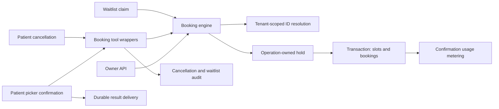

# Scope and how to use
Reviewed 9 November 2026 against the local working tree. This maps current implementation; proposed checks are explicitly labeled. Start from the row matching your change, follow [identifier contracts](identifier-contracts.md), then select checks from [booking evidence](booking-evidence.md). See [booking lifecycle](booking.md) for the overview.

# Entry points and downstream impact
| Change surface | Actual call chain | Boundary to preserve | Follow-on impact |
|---|---|---|---|
| Owner creates booking | POST /api/bookings → create_booking_api → engine.create_booking → hold_slot → confirm_booking | tenant from require_tenant; string IDs in payload; operation key from request_id | slot ownership, booking references, usage metering; API returns serialized engine result |
| Owner cancels or moves | PATCH /api/bookings/{id} → update_booking_api → cancel_booking or move_booking | tenant from authentication; owner path does not supply a patient contact constraint | previous/new slot ownership and status; 404/409/422 handling |
| Patient confirms picker | inbound._handle_booking_action → booking_create or booking_move → engine | selected slot must occur in persisted picker; date_confirmed=True at confirmed action; move passes contact_id | persisted booking_flow, result reply, delivery operation key |
| Patient cancels appointment | inbound intent cancel → booking_cancel → engine.cancel_booking | contact-constrained lookup and cancellation in worker path | audit entry and waitlist offer audit records |
| Direct agent-tool caller | booking_create / booking_move / booking_cancel → engine | create/move require date_confirmed; cancel/move contact_id is optional in the wrapper, so callers must enforce patient ownership | tool result schema and worker failure handling |
| Waitlist claim | engine.claim_waitlist_slot → hold_slot → confirm_booking → Waitlist.update_one | operation key is waitlist:{slot_id}:{contact_id}; same tenant | fulfilled waitlist row depends on practitioner/date and reference representation |

Owner routes are in source 2; worker paths in source 3; wrappers in sources 4-6. The call chains describe direct calls, not an assumption that every booking passes through the LLM graph.[^s2][^s3][^s4][^s5][^s6]

# State and write boundaries
| Operation | Guard and mutation | Changes that require broader review |
|---|---|---|
| hold_slot | open, expired held, or same hold_owner; writes held + 120-second expiry | lock duration, operation-key format, expired-hold behavior and contention |
| confirm_booking | request_id retry lookup; own unexpired hold; writes booked slot + booking in transaction | unique tenant/request_id index, ObjectId references, rollback and concurrent requests |
| cancel_booking | resolves booking; optional contact filter; accepts confirmed/rescheduled; repeated cancelled returns existing | releases only a booked slot linked to this booking; cancellation does not release another booking's slot |
| move_booking | resolves booking/new slot; acquires hold before transaction; optional contact filter; confirmed/rescheduled only | new slot → booking → old slot mutations; hold may remain until expiry when later checks fail; retry semantics differ from create |

These guards are implemented in the engine. Real transactions are selected when mock adapters are disabled; mock mode bypasses sessions. A successful mock run cannot prove multi-document atomicity.[^s1]

# Secondary effects people miss
- Confirmation attempts usage metering after the booking transaction and logs metering failures. A request_id early return skips this post-transaction work; review accounting recovery if retry behavior changes.[^s1][^s8]
- The booking_cancel wrapper adds audit/waitlist work; owner API cancellation calls the engine directly. Do not assume all callers get wrapper side effects.[^s2][^s6]
- Cancellation's waitlist loop records outbound_template audit events; that loop does not itself call a provider sender. This map does not claim actual waitlist notification delivery.[^s6]
- Worker success delivery follows the booking operation and uses booking-result:{request_id}; change that key only with duplicate-delivery regressions.[^s3]
- The unique booking request index is scoped by tenant and applies to string request_id values. Stored slot/booking references and request IDs have different jobs.[^s7]

# Review targets before the next booking change
1. Contact existence: confirm_booking retains the caller's contact string when contact resolution returns no record. Do not describe it as enforcing contact foreign-key integrity. Decide compatibility behavior before tightening it.
2. Create retry equivalence: create/confirm return the booking found by tenant + request_id without checking that slot/contact/service match the repeated payload. Add a changed-payload retry regression before changing that contract.
3. Move retries: move_request_id is written but there is no create-style early deduplication lookup. Review a repeated move to the already booked target, same-slot move, and failed ownership checks after target hold acquisition.
4. Waitlist generated IDs: booking creation resolves contacts, but final Waitlist.update_one uses the caller's contact_id value directly. Add a generated-reference fulfillment case before claiming complete ID coverage.

These are code-inspection findings for a follow-up, not reproduced defects or release closures. The selected existing tests and their limits are recorded in [booking evidence](booking-evidence.md). Release authority remains [release evidence](release-evidence.md).

# Sources
[^s1]: [app/booking/engine.py](file:///D:/XOLVER/Vaani/app/booking/engine.py)
[^s2]: [app/owner_api/routes.py](file:///D:/XOLVER/Vaani/app/owner_api/routes.py)
[^s3]: [app/workers/inbound.py](file:///D:/XOLVER/Vaani/app/workers/inbound.py)
[^s4]: [app/agent/tools/booking_create.py](file:///D:/XOLVER/Vaani/app/agent/tools/booking_create.py)
[^s5]: [app/agent/tools/booking_move.py](file:///D:/XOLVER/Vaani/app/agent/tools/booking_move.py)
[^s6]: [app/agent/tools/booking_cancel.py](file:///D:/XOLVER/Vaani/app/agent/tools/booking_cancel.py)
[^s7]: [app/models/collections.py](file:///D:/XOLVER/Vaani/app/models/collections.py)
[^s8]: [app/billing/meters.py](file:///D:/XOLVER/Vaani/app/billing/meters.py)
