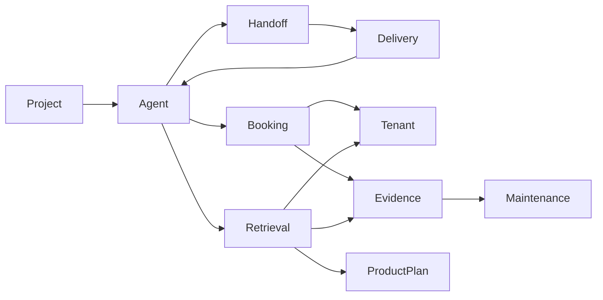

# Vaani engineering knowledge

Start at [Vaani project map](project.md). This is a source-backed draft at commit 804daa18c83b39e5785ba9ddcf9f534b1e8a7aa4, created 9 November 2026. It contains engineering knowledge, not approved clinic content or patient data.

## Concepts
- [Vaani project map](project.md) - What Vaani does and where to start a change.
- [Message and agent flow](agent-flow.md) - Scope routing connects tools, grounded replies, and handoff.
- [Tenant and identifier boundaries](tenant-isolation.md) - Explicit clinic context and MongoDB identifiers constrain data access.
- [Booking lifecycle](booking.md) - Shared hold, confirm, cancel, and move operations connect slots to bookings.
- [Durable receipt and delivery](delivery.md) - MongoDB durable work and Redis dispatch connect provider ingress to replies.
- [Human handoff](handoff.md) - Escalation changes conversation ownership and coordinates staff notification.
- [Retrieval and grounded answers](retrieval.md) - Tenant-filtered KB search feeds cited facts to the responder and output gate.
- [Release evidence and open acceptance](release-evidence.md) - The remediation ledger is authoritative for current acceptance status.
- [Maintain the knowledge graph](maintenance.md) - Update affected concepts with code changes and review source drift.
- [Clinic knowledge retrieval next](product-retrieval-plan.md) - A staged plan for using curated clinic knowledge inside Vaani.

## Relationship overview

## Use it today
Ask: "Read docs/knowledge/index.md and follow only relevant concepts. Trace the booking ID boundary, cite current source paths and tests, and distinguish implemented behavior from pending acceptance."

Search locally with `rg -n -i "booking|tenant|retrieval" docs/knowledge`.
Run `python ops/knowledge.py check` for graph integrity and source drift.
